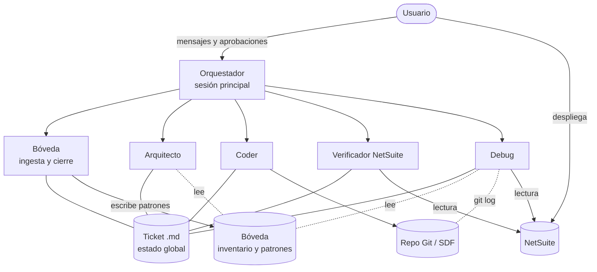
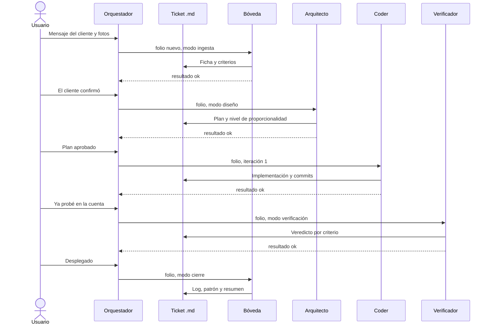
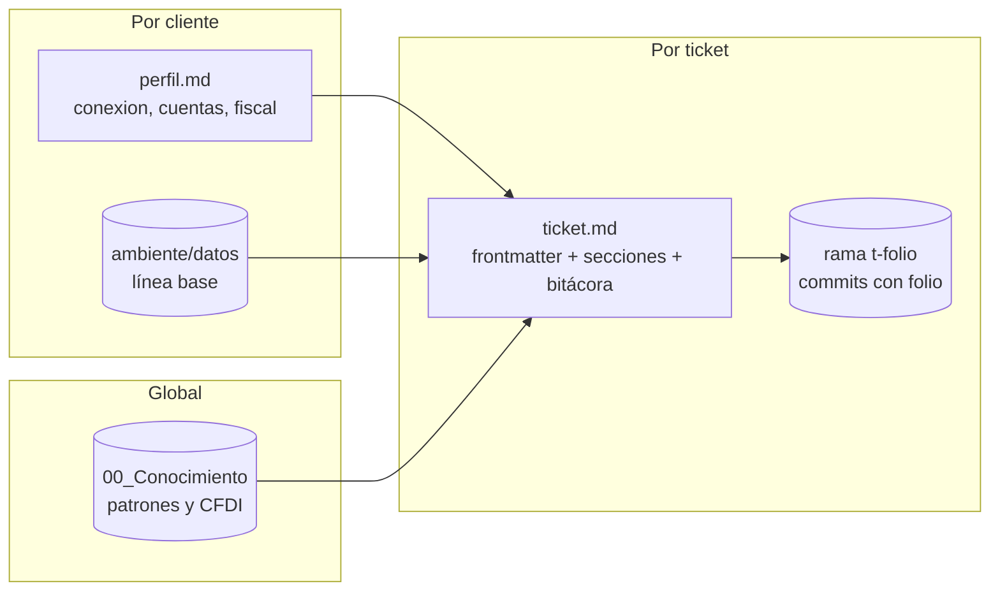
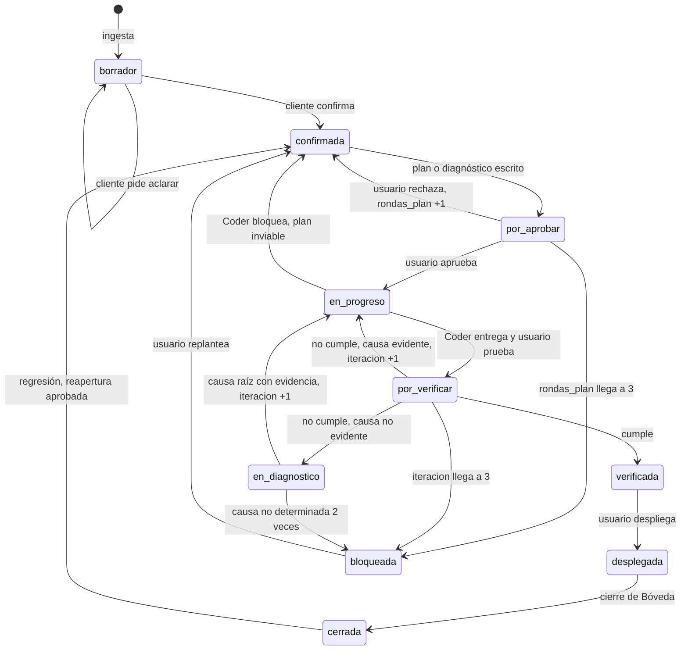

# Arquitectura multiagente – Flujo de desarrollo NetSuite v0.4.1

Versión 0.4.1 · 2026-11-09

## Acerca de esta versión

Este documento es la definición completa del sistema. Integra el diseño v0.4 sin cambios de contenido y la información de la sesión de diseño entregada en el traspaso del kit v0.4: estado de implementación, estructura de carpetas, decisiones, supuestos, métricas, propuestas para las inconsistencias conocidas, pendientes y los artefactos escritos del kit v0.3.0. No incorpora correcciones nuevas.

### Fuentes

| Fuente | Fecha | Aporta | Ubicación en este documento |
|---|---|---|---|
| Diseño v0.4 (`Arquitectura multiagente – Flujo de desarrollo NetSuite v0.4.md`, @Alex) | 2026-11-04 | Diseño de la arquitectura | Resumen y secciones 1 a 6 |
| Traspaso del kit v0.4, generado por la sesión de diseño | Corte 2026-11-09 | Estado de implementación, estructura, decisiones, supuestos, métricas, inconsistencias con propuestas, pendientes y artefactos v0.3.0 | Secciones 7 a 13 y Anexos A a E |

Las inconsistencias a–h de la sección 12 las enumeró la sesión que solicitó el traspaso; las respuestas y propuestas son de la sesión de diseño.

### Mapa del documento

| Sección | Contenido | Fuente |
|---|---|---|
| Resumen, 1 a 6 | Agentes, herramientas, patrón de comunicación, estado, errores y loops, riesgos | v0.4 |
| 7 | Estado de implementación e inventario de artefactos | Traspaso |
| 8 | Estructura de carpetas de la bóveda y del repo del cliente | Traspaso |
| 9 | Registro de decisiones D1 a D27 | Traspaso |
| 10 | Estado de los supuestos S1 a S32 | Traspaso |
| 11 | Métricas | Traspaso |
| 12 | Inconsistencias del documento v0.4 y propuestas | Traspaso |
| 13 | Pendientes P1 a P13 | Traspaso |
| Anexos A a E | Contenido íntegro de los artefactos del kit v0.3.0 | Traspaso |

### Marcas

| Marca | Significado |
|---|---|
| `[decisión]` | Acordado con el usuario en la sesión de diseño |
| `[verificado]` | Comprobado con evidencia: ejecución, archivo o fuente citada |
| `[supuesto]` | No comprobado; incluye las propuestas que el usuario no aprobó de forma explícita |

El texto de v0.4 (Resumen a sección 6) conserva su marca original "(supuesto)" en prosa.

Sustituciones aplicadas a todo el contenido, incluido el que se reproduce tal cual: los ejemplos ficticios de ID de cuenta se reemplazaron por `<ACCOUNT_ID>` (en minúsculas, `<account_id>`, donde el original iba en minúsculas) y el nombre de cliente ficticio de un comentario se reemplazó por `<CLIENTE>`. No hay otras modificaciones. `[verificado]`

### Cambios editoriales

| Fuente | Cambio |
|---|---|
| v0.4 | Se omitió la línea de fecha y autor; queda en la tabla de fuentes. Se agregaron cuatro notas marcadas "Nota v0.4.1". El resto del texto no cambió. |
| Traspaso | Se omitió el encabezado dirigido a la sesión receptora. La sección 1 pasó a la sección 7 y a los Anexos A a E; las secciones 2 a 7 pasaron a 8 a 13. Se ajustaron los niveles de encabezado y las referencias internas a la nueva numeración. El resto del texto no cambió. |

### Conflictos entre fuentes

Criterio: prevalece la fuente más reciente. Si no se puede determinar, se conservan ambas versiones y se marca "conflicto sin resolver". No quedó ningún conflicto sin resolver.

| # | Tema | v0.4 (2026-11-04) | Traspaso (2026-11-09) | Prevalece |
|---|---|---|---|---|
| C1 | Delegación entre subagentes | Se afirma que Claude Code no permite que un subagente delegue en otro (secciones 3 y 6) | `[supuesto]` S9: afirmado sin evidencia directa | Traspaso: `[supuesto]` |
| C2 | Proyecto SDF en `sdf/` y dos servidores MCP | Listado como cambio de la revisión (sección 6) | `[supuesto]` D26: incluido sin aprobación explícita del usuario | Traspaso: `[supuesto]`, pendiente P2 |
| C3 | Tres puertas humanas | Se enuncian sin enumerarlas | `[decisión]` D24 las enumera; la prueba manual en la cuenta no es puerta (sección 12, inciso f) | Traspaso. Precisa, no contradice. |
| C4 | Skills precargadas | Máximo dos por agente (sección 1) | Los agentes v0.3 `arquitecto` y `coder` precargan tres (Anexo A, README del Anexo E); D18 fija el máximo en dos | v0.4 y D18. Los artefactos v0.3 están pendientes de reescritura (P3). |
| C5 | Agentes, estados, contrato y plantillas | Cinco agentes, estados ampliados, contrato YAML, contadores y Bitácora | Los artefactos v0.3.0 tienen siete agentes, cinco estados, sin contadores ni Bitácora | v0.4. Los Anexos son la base v0.3.0 para construir v0.4 (P3, P4, P6). |

## Resumen

La arquitectura recomendada es un supervisor jerárquico que ejecuta una máquina de estados persistida en el archivo del ticket. El supervisor es la sesión principal de Claude Code. Trabaja con cinco subagentes especialistas y tres puertas humanas.

> Nota v0.4.1: las tres puertas humanas se enumeran en D24 (sección 9). Ninguno de los cinco agentes está escrito; el kit vigente es v0.3.0, con siete agentes (sección 7).

Esta revisión parte del diseño v0.3 y de los acuerdos posteriores: consolidación por permisos, agente Debug y modo sin MCP. Agrega tres piezas que faltaban: un orquestador explícito, un contrato de entrada y salida entre agentes, y límites de iteración con escalamiento.

| Decisión | Elección | Motivo |
| --- | --- | --- |
| Topología | Supervisor jerárquico con máquina de estados | En Claude Code la sesión principal delega y los subagentes no se comunican entre sí |
| Agentes | Orquestador y 5 especialistas | Se agrupan por permisos y por la confianza de su entrada, no por tema |
| Estado | Archivo del ticket, perfil, inventario y Git | Los subagentes no guardan memoria; el estado debe sobrevivir a sesiones y equipos |
| Loops | Acotados con contador y escalamiento | Evitan ciclos infinitos y rechazos repetidos sin información nueva |
| Acceso a NetSuite | Un puerto con tres adaptadores: `mcp`, `sdf`, `manual` | Hay clientes que no autorizarán MCP |
| Fuera de alcance | Contratos, cotizaciones, cobros y propiedad del código | Informativo; nunca bloquea el flujo |



El usuario es el único actor que despliega y el único que aprueba. Ningún subagente habla con otro: toda comunicación pasa por el orquestador y por el archivo del ticket.

## 1. Definición de agentes

Se necesitan un orquestador y cinco especialistas. La regla de agrupación es: se juntan las responsabilidades que usan las mismas herramientas y reciben entradas con el mismo nivel de confianza; se separan las que procesan texto del cliente o requieren más privilegios. La backstory va en la primera línea del prompt del agente, y su función es fijar el criterio, no el tono.

### Orquestador (sesión principal de Claude Code)

| Atributo | Definición |
| --- | --- |
| Rol | Dueño del flujo. Lee el estado del ticket, aplica la tabla de transiciones, delega al agente que corresponde y hace cumplir las puertas y los límites. |
| Backstory | Jefe de proyecto técnico que no programa. Su valor es que nada avance sin cumplir su condición de salida. |
| Metas | Ninguna transición sin precondición. Toda delegación con folio y modo. Es el único que escribe `estado` y los contadores. |
| Skills | `orquestacion-ticket` (nueva): tabla de transiciones, límites y formato del contrato |
| No hace | No diseña, no programa, no diagnostica, no consulta NetSuite |

### Bóveda (modos ingesta y cierre)

| Atributo | Definición |
| --- | --- |
| Rol | Único punto de entrada y salida de información. En ingesta convierte el mensaje del cliente en una ficha; en cierre escribe el log privado, la ficha de conocimiento y el resumen para el cliente. |
| Backstory | Analista de soporte que convierte conversaciones informales en requerimientos verificables y después archiva lo aprendido sin exponer al cliente. |
| Metas | Ficha con un máximo de 5 criterios verificables y ningún dato inventado. Ficha de conocimiento sin identificadores del cliente. |
| Skills | Precargada: `documentador-boveda`. Bajo demanda: `netsuite-sdf-project-documentation`. |
| No hace | No propone soluciones, no consulta NetSuite, no ejecuta comandos. Recibe texto no confiable, por eso no tiene Bash ni MCP. |

### Arquitecto

| Atributo | Definición |
| --- | --- |
| Rol | Diseña la solución de los requerimientos. Declara el nivel de proporcionalidad (0 a 3), cita antecedentes de la bóveda y propone las consultas de verificación. |
| Backstory | Arquitecto SuiteCloud con experiencia en la localización mexicana, que elige la solución más simple que cumple los criterios. |
| Metas | Plan aprobado en un máximo de 2 rondas (supuesto). Nivel de proporcionalidad justificado. Antecedentes citados o "sin antecedentes" declarado. |
| Skills | Precargadas: `netsuite-plan-diseno`, `netsuite-arquitectura-limpia`. Bajo demanda: `netsuite-sdf-safe-guide`, `netsuite-suitescript-records-reference`, `fiscal-cfdi` (modo diseño), `netsuite-sdf-roles-and-permissions`. |
| No hace | No escribe código ni consulta la cuenta; trabaja con el inventario de la bóveda. |

### Coder

| Atributo | Definición |
| --- | --- |
| Rol | Implementa el plan aprobado en la rama `t-<folio>` y hace una autorrevisión antes del commit. |
| Backstory | Desarrollador SuiteScript 2.1 disciplinado con la gobernanza, que trata cada commit como evidencia rastreable. |
| Metas | Cada commit con el folio en el mensaje. Ninguna desviación del plan sin declararla. Nunca agrega capas que el nivel de proporcionalidad no pide. |
| Skills | Precargadas: `netsuite-sdf-safe-guide`, `netsuite-arquitectura-limpia`. Bajo demanda: `netsuite-owasp-secure-coding`, `netsuite-suitescript-records-reference`, `netsuite-suitescript-upgrade`, `fiscal-cfdi`. |
| No hace | No despliega. No cambia el diseño: si el plan no es viable, lo devuelve como bloqueo. |

### Verificador NetSuite (modos verificación y levantamiento)

| Atributo | Definición |
| --- | --- |
| Rol | Verifica los criterios de aceptación contra la cuenta, valida el XML fiscal cuando aplica, y levanta y compara el inventario del ambiente. |
| Backstory | QA con mentalidad de auditor: pocas pruebas, y cada una demuestra algo. |
| Metas | Máximo 5 consultas por ticket. Veredicto y evidencia por criterio. Ninguna consulta en producción sin confirmación. |
| Skills | Precargada: `netsuite-ai-connector-instructions`. Bajo demanda: `levantamiento-ambiente`, `fiscal-cfdi` (modo validación). |
| No hace | No modifica datos ni código. No inventa consultas fuera del plan sin justificarlas. |

### Debug

| Atributo | Definición |
| --- | --- |
| Rol | Encuentra la causa raíz de una falla con evidencia, en contexto de iteración (dentro del ticket) o de post-despliegue (puede proponer reabrir un ticket anterior). |
| Backstory | Ingeniero de soporte de nivel 3 que no acepta una causa sin evidencia que la sostenga. |
| Metas | Causa raíz con evidencia, o "no determinada" con las hipótesis descartadas. Ruta de corrección. Folio de origen cuando la falla es regresiva. |
| Skills | Precargada: `debug-netsuite` (nueva). Bajo demanda: `fiscal-cfdi` (modo diagnóstico), `netsuite-sdf-safe-guide`, `netsuite-suitescript-records-reference`, `netsuite-ai-connector-instructions`. |
| No hace | No crea tickets: exige un folio. No escribe código. |

`fiscal-cfdi` es la única fuente de verdad fiscal y tiene tres modos: diseño (Arquitecto), diagnóstico (Debug) y validación (Verificador). Ningún agente precarga más de dos skills; el resto entra solo cuando el ticket lo requiere.

## 2. Herramientas

Cada agente recibe solo las herramientas que su rol exige; la lista permitida de su archivo es el control técnico, y el prompt es solo el respaldo. No se usan bases vectoriales, raspadores web ni APIs propias: la bóveda se consulta por texto y NetSuite se accede por un puerto con tres adaptadores.

### Matriz de herramientas

| Herramienta | Orquestador | Bóveda | Arquitecto | Coder | Verificador | Debug |
| --- | --- | --- | --- | --- | --- | --- |
| Read, Glob, Grep | Sí | Sí | Sí | Sí | Sí | Sí |
| Write, Edit en la bóveda | Solo frontmatter | Sí | Sección Plan | Sección Implementación | Sección Verificación e inventario | Sección Diagnóstico |
| Write, Edit en el repo | No | No | No | Sí | No | No |
| Bash | No | No | No | Repo y Git, sin deploy | Solo scripts del kit | Solo lectura: `git log`, `git diff`, `git blame` |
| Skill | Sí | Sí | Sí | Sí | Sí | Sí |
| MCP `ns_runCustomSuiteQL` | No | No | No | No | Sí | Sí |
| MCP `ns_getSubsidiaries` | No | No | No | No | Sí | No |
| Delegar a subagentes | Sí | No | No | No | No | No |

El nombre `ns_runCustomSuiteQL` está confirmado en la skill oficial de Oracle. El prefijo `mcp__netsuite__` que Claude Code le antepone se confirma con `/mcp` en el equipo. Las restricciones de Bash por agente son instrucciones del prompt; la única restricción técnica actual es la denegación de `suitecloud project:deploy` en el repo.

### Scripts deterministas

Toda operación que debe dar siempre el mismo resultado la hace un script, no el modelo.

| Script | Lo usa | Función |
| --- | --- | --- |
| `nuevo-cliente.mjs` | Usuario | Alta del cliente, URL del MCP y detección de entorno |
| `diff-ambiente.mjs` | Verificador | Altas, bajas y cambios del inventario contra la línea base |
| `importar-resultado.mjs` (nuevo) | Verificador, Debug | Convierte un CSV exportado o el JSON de la consola al formato del inventario |
| Hook `PreToolUse` de producción (propuesto) | Claude Code | Bloquea llamadas MCP a un host sin `-sb` salvo que exista una confirmación fechada del día creada por el usuario |

El hook convierte la confirmación de producción de una instrucción del prompt en una barrera técnica. Es la mejora de seguridad con mejor relación costo-beneficio de esta revisión.

### Adaptadores de acceso a NetSuite

El campo `conexion` del perfil decide el adaptador. Las etapas del flujo no cambian.

| Función | `mcp` | `sdf` | `manual` |
| --- | --- | --- | --- |
| Consultas de verificación | MCP directo | El agente genera la consulta; tú la ejecutas en la consola del navegador y guardas el JSON | Igual que `sdf` |
| Inventario de objetos | SuiteQL por MCP | `suitecloud object:list` (supuesto: filtro por tipo) | CSV de búsquedas guardadas |
| Logs para Debug | SuiteQL si la tabla está disponible (supuesto) | Exportación CSV desde la UI | Igual que `sdf` |
| Despliegue | SDF, por el usuario | SDF, por el usuario | File Cabinet y UI, por el usuario |

### Herramientas descartadas

| Herramienta | Motivo | Cuándo reconsiderarla |
| --- | --- | --- |
| Base de datos vectorial | La bóveda es pequeña y el vocabulario controlado permite búsqueda exacta por texto | Cuando el Arquitecto o el Debug no encuentren fichas que sí existen |
| Raspado web y búsqueda web | Contenido no confiable con riesgo de inyección de prompt; las fuentes fiscales se descargan y versionan a mano | Si el piloto muestra que el Debug necesita documentación de Oracle que no está en las skills; en ese caso, solo el Debug y solo dominios de Oracle |
| RESTlet propio | Agrega despliegue, autenticación y mantenimiento por cuenta | Si un caso exige leer algo que ni MCP ni la consola exponen |

## 3. Patrón de comunicación

El patrón correcto es híbrido: un supervisor jerárquico decide quién actúa, y una máquina de estados explícita decide cuándo puede actuar. Los agentes no se hablan entre sí. Se comunican mediante un contrato fijo con el orquestador y escriben en secciones del ticket.

### Comparación de patrones

| Patrón | Ajuste a este caso | Motivo |
| --- | --- | --- |
| Secuencial en cadena | Insuficiente | El flujo tiene tres ciclos de retorno y dos rutas (requerimiento y bug); una cadena rígida no los expresa |
| Red libre entre agentes | Descartado | Claude Code no permite que un subagente delegue en otro, y la comunicación directa rompe la trazabilidad y las puertas humanas |
| Grafo de estados puro (estilo LangGraph) | Correcto en concepto, sobredimensionado en infraestructura | Requiere un runtime propio; el mismo efecto se logra con una tabla de transiciones y un campo `estado` en un archivo |
| Supervisor jerárquico con máquina de estados | Elegido | Coincide con el modelo de ejecución de Claude Code y hace las transiciones deterministas y auditables |

El supervisor no improvisa la ruta. La tabla de transiciones vive en la skill `orquestacion-ticket` y es la misma en todos los tickets.

### Tabla de transiciones

| Estado actual | Evento | Actúa | Estado siguiente |
| --- | --- | --- | --- |
| (sin ticket) | Mensaje del cliente | Bóveda, modo ingesta | `borrador` |
| `borrador` | El cliente confirma | Arquitecto (requerimiento) o Debug (bug) | `confirmada` |
| `confirmada` | Plan o diagnóstico escrito | Usuario (puerta) | `por_aprobar` |
| `por_aprobar` | El usuario aprueba | Coder | `en_progreso` |
| `en_progreso` | Coder entrega | Usuario prueba en la cuenta | `por_verificar` |
| `por_verificar` | El usuario reportó su prueba | Verificador | `verificada` o vuelve a `en_progreso` |
| `verificada` | El usuario despliega (puerta) | Bóveda, modo cierre | `desplegada`, después `cerrada` |
| Cualquiera | Bloqueo o límite de iteración alcanzado | Usuario | `bloqueada` |

Esta tabla amplía los estados del kit v0.3 (`borrador`, `confirmada`, `en_progreso`, `desplegada`, `cerrada`) con `por_aprobar`, `por_verificar`, `verificada` y `bloqueada`. Los nuevos estados permiten saber, solo con el frontmatter, quién tiene el turno.

### Contrato entre orquestador y agentes

Entrada: el mensaje de delegación del orquestador. Es lo único que recibe el subagente, además de su propio prompt.

```yaml
folio: T-2026-014
agente: verificador
modo: verificacion            # ingesta | cierre | verificacion | levantamiento | iteracion | post_despliegue
ruta_ticket: <BOVEDA_CLIENTE>/tickets/T-2026-014.md
iteracion: 2
instrucciones: "texto del usuario, si aplica"
```

Salida: un bloque YAML al final de la respuesta del subagente.

```yaml
folio: T-2026-014
agente: verificador
resultado: rechazo            # ok | rechazo | bloqueo
seccion_escrita: Verificación
siguiente_sugerido: coder     # el orquestador decide con la tabla, no con esta sugerencia
motivo: "Criterio 2 no cumple: el campo queda vacío en la factura de prueba"
evidencia: ["consulta 2", "registro de prueba indicado por el usuario"]
causa_evidente: true          # solo Verificador: decide entre Coder y Debug
```

Reglas del contrato: el subagente no cambia `estado`; un `rechazo` o `bloqueo` sin `motivo` y `evidencia` se trata como inválido y se repite la delegación una vez; el detalle largo va en la sección del ticket, no en la respuesta.



## 4. Gestión del estado

El estado global vive en archivos, no en la conversación. El frontmatter del ticket es la única fuente de verdad del flujo, y cada variable tiene un solo escritor. Así el sistema se puede retomar en otra sesión, en otro equipo o después de una interrupción, con solo leer el ticket.

### Por qué en archivos

| Razón | Consecuencia si el estado viviera en la conversación |
| --- | --- |
| Los subagentes no guardan memoria entre invocaciones | Cada delegación tendría que reconstruir el contexto a partir del chat, con riesgo de omitir datos |
| Las sesiones terminan y cambias de equipo | Un ticket a medias se perdería al cerrar la terminal |
| El estado debe ser legible y editable por ti | No podrías corregir un dato mal registrado sin reiniciar el flujo |
| Las métricas salen de Dataview | No habría tablero |

### Capas de estado



### Variables críticas del ticket

| Variable | Escribe | La usa | Por qué es crítica |
| --- | --- | --- | --- |
| `folio` | Bóveda (ingesta) | Todos | Llave de todo: rama, commits, delegaciones. El Debug no actúa sin él. |
| `cliente_id` | Bóveda | Todos | Selecciona el perfil y aísla los datos del cliente |
| `tipo` | Bóveda | Orquestador | Decide la ruta: Arquitecto para requerimientos, Debug para bugs |
| `impacto_fiscal` | Bóveda; el Arquitecto y el Debug solo pueden cambiarlo de `false` a `true` | Arquitecto, Coder, Verificador, Debug | Activa `fiscal-cfdi`. El cambio en un solo sentido evita que un agente apague una revisión fiscal. |
| `estado` | Orquestador | Orquestador, Dataview | Dice quién tiene el turno |
| `iteracion` | Orquestador | Orquestador, Coder, Debug | Contador del ciclo Coder-Verificador; dispara el escalamiento |
| `rondas_plan` | Orquestador | Orquestador | Contador de rechazos del plan |
| `nivel_proporcionalidad` | Arquitecto | Coder | Impide que el Coder agregue capas que el diseño no pidió |
| `rama` | Coder | Debug | Ubica el código del ticket |
| `entorno_verificado` | Verificador | Usuario, Bóveda | Registra si la evidencia salió de Sandbox o de producción |
| `reabierto`, `ticket_origen` | Orquestador, tras tu aprobación de la propuesta del Debug | Dataview | Alimentan la métrica 1, errores que llegan a producción |
| `bloqueo_motivo` | Orquestador | Usuario | Explica por qué el ticket se detuvo |
| `fecha_recepcion`, `fecha_confirmada`, `fecha_plan`, `fecha_deploy` | Bóveda la primera; el Orquestador las de las puertas | Dataview | Métricas de tiempo de diagnóstico y ciclo |

Variables del cliente, en el perfil: `conexion` (`mcp`, `sdf` o `manual`), cuentas con su URL del MCP, `solucion_fiscal` y `fecha_ultimo_levantamiento`. Las escribe el usuario o el Verificador en modo levantamiento.

### Reglas de gestión

1. Un escritor por variable. Si dos agentes necesitan cambiar un dato, uno lo escribe y el otro lo solicita mediante `bloqueo` con motivo.
2. Los criterios de aceptación no cambian después de `confirmada`. Un cambio de alcance regresa el ticket al cliente.
3. La sección Bitácora del ticket solo admite agregar. El Orquestador escribe una línea por delegación: fecha, agente, modo, resultado y motivo corto. Ahí se detectan rechazos repetidos.
4. Al iniciar una sesión, el Orquestador valida que el `estado` coincida con las secciones escritas. Si no coinciden, por ejemplo `por_verificar` sin sección Implementación, lo reporta y no avanza.
5. Puedes editar el frontmatter a mano. La validación del punto 4 lo hace seguro.

## 5. Manejo de errores y loops

Todo rechazo debe traer motivo y evidencia. El ticket regresa al agente más cercano que puede corregir la causa, y cada ciclo tiene un límite: al alcanzarlo, el ticket pasa a `bloqueada` y te escala. Un rechazo que repite el mismo motivo que el anterior escala de inmediato, porque indica que el ciclo ya no produce información nueva.



El estado transitorio `en_diagnostico` se suma a la tabla de transiciones de la sección 3 para la iteración con Debug.

### Rechazos entre agentes

| Rechaza | A | Condición | Reacción | Límite (supuesto) | Al llegar al límite |
| --- | --- | --- | --- | --- | --- |
| Cliente | Bóveda | La ficha no refleja lo que pidió | La Bóveda reescribe con sus aclaraciones | Sin límite; lo controla una persona | — |
| Arquitecto | Bóveda | Criterio ambiguo o no verificable | Vuelve a `borrador` con preguntas para el cliente | 2 | Lo resuelves tú directamente con el cliente |
| Usuario | Arquitecto | El plan no convence | El Arquitecto rehace el plan con tus observaciones | 3 rondas | `bloqueada`: replantear el alcance |
| Coder | Arquitecto | Plan inviable: gobernanza, campo inexistente, límite de plataforma | `bloqueo` con motivo; el Arquitecto ajusta | Cuenta como ronda de plan | Igual que la fila anterior |
| Verificador | Coder | No cumple y la causa es evidente | El Coder corrige en la misma rama | 3 iteraciones compartidas con la fila siguiente | `bloqueada`: revisión del diseño con el Arquitecto |
| Verificador | Debug | No cumple y la causa no es evidente | Debug en modo iteración; después, Coder | Mismo contador | Igual que la fila anterior |
| Usuario | Debug | El diagnóstico no tiene evidencia suficiente | Debug con los datos nuevos que aportes | 2 | `bloqueada`: se necesita reproducir la falla |
| Orquestador | Cualquiera | La salida no cumple el contrato | Repite la delegación una vez | 1 | `bloqueada` con la salida inválida anexada |

### Fallas técnicas

| Falla | Reacción | Por qué |
| --- | --- | --- |
| MCP responde 403 o falta un permiso | Registrar la limitación del rol y resolver ese paso con el adaptador manual | Buscar rutas alternas produce consultas no aprobadas |
| MCP no responde | Un reintento; después, adaptador manual | Que no responda no significa que no haya datos |
| Host sin `-sb` y sin confirmación | Detener sin consultar | Ante una duda sobre el entorno, la falla debe ser cerrada |
| Error del script de diferencias | No aplicar la línea base | Una línea base corrupta genera falsas bajas en todas las comparaciones siguientes |
| Skill no precargada | Invocarla con la herramienta Skill; si no existe, declararlo y continuar | Hay un reporte abierto de fallas en la precarga |
| Conflicto de Git en la rama | `bloqueo` hacia el usuario | Resolver conflictos requiere decidir qué código prevalece |
| Falla en producción después del despliegue | Ficha nueva de tipo bug; el Debug rastrea con `git blame` y propone reabrir el ticket de origen | Medir bien la métrica 1 depende de no registrar las regresiones como tickets nuevos |

Los límites de 2 y 3 son valores iniciales sin medición. Se ajustan con los datos de la bitácora después de los primeros tickets.

## 6. Riesgos, supuestos y verificación

El diseño es sólido para un desarrollador único, con un riesgo dominante: varios controles todavía son instrucciones de prompt y no barreras técnicas. El hook de producción y la validación de estado al iniciar la sesión son las dos mejoras que reducen ese riesgo.

### Riesgos

| Riesgo | Fundamento | Consecuencia | Mitigación |
| --- | --- | --- | --- |
| Las restricciones de Bash por agente dependen del prompt | La lista de herramientas permite Bash completo | Un agente desviado podría ejecutar comandos fuera de su alcance | Reglas `deny` adicionales en `settings.json` y el hook de producción |
| El Orquestador es la sesión principal, que también conversa contigo | Comparte contexto con instrucciones libres del usuario | Podría saltarse una transición si se lo pides de forma ambigua | La skill `orquestacion-ticket` y la validación de estado al iniciar |
| La precarga de skills puede fallar | Existe un reporte abierto sobre el campo `skills` | El agente arranca sin su conocimiento de dominio | Instrucción de invocarlas con Skill y una pregunta de control en el piloto |
| Los límites de iteración son supuestos | No hay datos históricos | Límites demasiado bajos bloquean tickets sanos; demasiado altos consumen tiempo | Ajustarlos con la bitácora tras unos 10 tickets |
| En los modos `sdf` y `manual`, la verificación la ejecutas tú | Sin MCP no hay consulta automática | Cada consulta cuesta tiempo humano | El límite de 5 consultas se vuelve obligatorio |

### Supuestos por validar en el piloto

1. El prefijo `mcp__netsuite__` de las herramientas MCP en Claude Code.
2. La disponibilidad de las tablas del catálogo de levantamiento y de los logs de ejecución por SuiteQL con un rol de solo lectura.
3. El filtro por tipo de `suitecloud object:list`.
4. El uso de `N/query` desde la consola del navegador en cada cuenta.
5. Que `suitecloud project:create` crea una subcarpeta con el nombre del proyecto.

> Nota v0.4.1: el registro completo de supuestos, con su estado y evidencia, está en la sección 10 (S1 a S32).

### Cambios que implica esta revisión (kit v0.4)

| Cambio | Tipo |
| --- | --- |
| Consolidar de 7 a 5 agentes, agrupados por permisos | Agentes |
| Agente Debug y skill `debug-netsuite` | Nuevo |
| Skill `orquestacion-ticket` con la tabla de transiciones y el contrato | Nuevo |
| Estados `por_aprobar`, `por_verificar`, `verificada`, `en_diagnostico` y `bloqueada`; variables `iteracion`, `rondas_plan`, `ticket_origen` y `bloqueo_motivo`; sección Bitácora | Plantilla de ticket |
| `fiscal-cfdi` con tres modos | Skill |
| Campo `conexion` y script `importar-resultado.mjs` | Modo sin MCP |
| Hook `PreToolUse` de producción | Seguridad |
| Proyecto SDF en `sdf/` y dos servidores MCP, Sandbox y producción | Alta de cliente |

> Nota v0.4.1: el cambio "Proyecto SDF en `sdf/` y dos servidores MCP" es `[supuesto]`, sin aprobación explícita del usuario (D26, P2). El hook `PreToolUse` también es `[supuesto]` (D27). Ver conflicto C2.

### Verificación

Esta revisión es de diseño y no se ejecutó código. Contrasté el diseño con el kit v0.3: las skills de Oracle existen en el [repositorio oficial](https://github.com/oracle/netsuite-suitecloud-sdk) y el nombre `ns_runCustomSuiteQL` aparece en su skill de AI Connector. El comportamiento de los subagentes de Claude Code (campo `skills`, ausencia de delegación entre subagentes) se tomó de su documentación y de reportes públicos, sin prueba en un equipo. Los límites y tiempos son supuestos sin medición.

> Nota v0.4.1: la imposibilidad de delegar entre subagentes quedó registrada después como `[supuesto]` S9 (sección 10). Prevalece esa marca. Ver conflicto C1.

## 7. Estado de implementación

- `[verificado]` El último kit escrito y empaquetado es la versión 0.3.0 (`netsuite-agent-kit.zip`, 67 archivos). Contiene 7 agentes, no 5.
- `[verificado]` La versión 0.4 existe solo como diseño: el documento de arquitectura y los acuerdos de esta sesión. Ningún artefacto nuevo de v0.4 se escribió.
- `[decisión]` El trabajo de la siguiente sesión es construir v0.4 a partir de los artefactos v0.3 de los Anexos A a E, aplicando las decisiones de la sección 9 y resolviendo las inconsistencias de la sección 12.

### 7.1 Inventario de artefactos

| Artefacto | Ruta en el kit | Estado | Marca |
|---|---|---|---|
| Agentes v0.3: ingesta, arquitecto, fiscal, coder, tester, levantamiento, documentador | `agents/*.md` | Escritos (v0.3). Se reproducen en el Anexo A. | `[verificado]` |
| Agentes v0.4: Bóveda, Arquitecto, Coder, Verificador NetSuite, Debug | — | Solo descritos en el documento v0.4. No escritos. | `[verificado]` |
| Instrucciones del Orquestador | `plantillas/cliente/CLAUDE.md` (v0.3) | La versión v0.3 es la plantilla `CLAUDE.md` del repo (Anexo D). La skill `orquestacion-ticket` no está escrita. | `[verificado]` |
| Skill `orquestacion-ticket` | — | Solo descrita. No escrita. | `[verificado]` |
| Skill `debug-netsuite` | — | Solo descrita: método de 5 pasos y catálogo inicial de 7 códigos de error. No escrita. | `[verificado]` |
| Skill `fiscal-cfdi` | `skills/fiscal-cfdi/SKILL.md` | Escrita en v0.3 con un solo modo. La versión de tres modos (diseño, diagnóstico y validación) no está escrita. | `[verificado]` |
| Skill `documentador-boveda` | `skills/documentador-boveda/` | Escrita (v0.3) | `[verificado]` |
| Skill `levantamiento-ambiente` | `skills/levantamiento-ambiente/` | Escrita (v0.3), con su script de diferencias | `[verificado]` |
| Skills propias preexistentes del usuario: `netsuite-plan-diseno`, `netsuite-arquitectura-limpia` | `skills/` | Incluidas en el zip por copia. No se definieron en esta sesión y no se reproducen aquí. | `[verificado]` |
| Skills de Oracle (7) | Fuera del kit; las descarga `install.mjs --oracle` | No se reproducen: son externas | `[verificado]` |
| `lib.mjs`, `install.mjs`, `nuevo-cliente.mjs` | `scripts/` | Escritos (v0.3) | `[verificado]` |
| `diff-ambiente.mjs` | `skills/levantamiento-ambiente/scripts/` | Escrito (v0.3) | `[verificado]` |
| `importar-resultado.mjs` | — | Solo descrito: convierte CSV o JSON de la consola al formato del inventario. No escrito. | `[verificado]` |
| Plantillas de ticket, perfil y ficha de conocimiento | `boveda/99_Plantillas/` | Escritas (v0.3). No incluyen los cambios de v0.4: estados nuevos, contadores, Bitácora y campo `conexion`. | `[verificado]` |
| `settings.json` del repo del cliente | `plantillas/cliente/.claude/settings.json` | Escrito (v0.3) | `[verificado]` |
| `settings.json` del usuario | `~/.claude/settings.json` | No es una plantilla; `install.mjs` le agrega la bóveda en `permissions.additionalDirectories` | `[verificado]` |
| Hook `PreToolUse` de producción | — | Solo descrito. No escrito. | `[verificado]` |
| `README.md` del kit, `Tablero.md`, `.gitignore`, README de carpetas | Varios | Escritos (v0.3). Se reproducen en el Anexo E. | `[verificado]` |

`[verificado]` Todo el contenido de los Anexos A a E se extrajo del zip v0.3.0 y se reproduce sin cambios, salvo las sustituciones descritas en "Acerca de esta versión".

## 8. Estructura de carpetas

### 8.1 Bóveda de Obsidian (raíz por defecto `~/NetSuite_KB`)

```
<BOVEDA>/
  Tablero.md                               [verificado] consultas Dataview
  00_Conocimiento/                         [decisión] compartido entre clientes, siempre anonimizado
    Patrones/                              fichas de conocimiento
    CFDI/                                  una nota por código de error SAT o PAC
      catalogos/                           catálogos SAT versionados por fecha de publicación
        xsd/                               [supuesto] esquemas XSD; la carpeta la crea el usuario
    Snippets/                              código genérico sin IDs de clientes
    Indices/                               notas centrales del vocabulario controlado
  01_Clientes/
    <CLIENTE>/                             [decisión] datos privados; nunca se enlazan desde 00_Conocimiento
      perfil.md
      tickets/<FOLIO>.md                   una nota por ticket con todas sus secciones
      adjuntos/<FOLIO>/                    fotos, XML timbrados y resultados manuales
      administrativo/                      [decisión] informativo; ningún agente lo lee
      ambiente/
        resumen.md
        historial.md
        diferencias-AAAA-MM-DD.md
        datos/<entidad>.json               línea base del inventario
        datos/_nuevo/<entidad>.json        extracción en curso (temporal)
  99_Plantillas/                           [verificado] el kit las sobrescribe al reinstalar
```

`[verificado]` `install.mjs` crea la estructura base y nunca sobrescribe notas existentes, salvo `99_Plantillas`. `[verificado]` `nuevo-cliente.mjs` crea `tickets/`, `adjuntos/`, `administrativo/` y `ambiente/datos/` (probado en Linux).

### 8.2 Repositorio del cliente (por defecto `~/Dev/clientes/<cliente_id>`)

```
<cliente_id>/
  CLAUDE.md                     [verificado] plantilla con rutas, cuenta y reglas
  .mcp.json                     [verificado] lo crea `claude mcp add --scope project`
  .claude/settings.json         [verificado] niega suitecloud project:deploy
  .gitignore                    [verificado]
  sdf/                          [supuesto] decisión v0.4 sin aprobación explícita; v0.3 no lo contempla
    src/
      manifest.xml              [supuesto] estructura estándar de un proyecto Account Customization
      deploy.xml
      FileCabinet/SuiteScripts/
      Objects/
```

| Elemento | Detalle | Marca |
|---|---|---|
| Servidores MCP | v0.3: uno, `netsuite`. v0.4: `netsuite` (Sandbox) y `netsuite-prod` (producción). | `[verificado]` v0.3 · `[supuesto]` v0.4 sin aprobación explícita |
| URL del MCP | `https://<account_id>.suitetalk.api.netsuite.com/services/mcp/v1/all`; en Sandbox, `<account_id>-sb<n>` | `[verificado]` formato tomado de fuentes de terceros sobre el AI Connector |
| Rama por ticket | `t-<folio en minúsculas>` | `[decisión]` |
| Mensaje de commit | `<FOLIO>: <qué cambia>` | `[decisión]` |

## 9. Registro de decisiones

| # | Decisión | Motivo | Alternativas descartadas | Marca |
|---|---|---|---|---|
| D1 | Claude Code como entorno de ejecución de los agentes | Subagentes con herramientas restringidas, acceso al sistema de archivos, SDF y Git | Projects de claude.ai (ligados a la cuenta, sin sistema de archivos); solo Claude Desktop con MCP locales | `[decisión]` |
| D2 | El flujo atiende uso interno y clientes externos, sin límite de clientes; tres capas: global, cliente y ticket | Escalar sin modificar agentes: un alta equivale a clonar la plantilla | Arquitectura por cliente | `[decisión]` |
| D3 | Usar el AI Connector Service oficial de Oracle | Ya estaba en uso; evita credenciales TBA locales | Puente MCP propio con TBA (propuesto en el documento original del usuario) | `[decisión]` |
| D4 | Tester de solo lectura por SuiteQL; las transacciones de prueba las ejecuta el usuario | El control real es el rol; evita escrituras de IA en la cuenta | Tester con creación de registros o ejecución de scripts | `[decisión]` |
| D5 | El Tester puede operar en producción: si el host no tiene `-sb`, avisa y pide confirmación | El usuario no quiso limitarlo a Sandbox | Solo Sandbox (decisión inicial, revertida por el usuario) | `[decisión]` |
| D6 | Pruebas puntuales: máximo 5 consultas por ticket, derivadas de los criterios de aceptación | Prioridad del usuario: intervenir a mano antes que crear pruebas innecesarias | Cobertura amplia de pruebas | `[decisión]` · el valor 5 es `[supuesto]` |
| D7 | Solo MCP; ningún RESTlet propio | Un RESTlet agrega despliegue y mantenimiento por cuenta | RESTlet de solo lectura (queda solo para un caso que lo exija) | `[decisión]` |
| D8 | Ingesta: el usuario pega el mensaje de WhatsApp y fotos; un agente genera una ficha formal que el cliente confirma | No automatizar WhatsApp; poder pasar a correo más adelante sin cambiar el formato de la ficha | Automatizar WhatsApp; herramienta de tickets | `[decisión]` |
| D9 | Una bóveda con carpetas por cliente y conocimiento compartido anonimizado | Reutilizar soluciones entre clientes sin exponer sus datos | Una bóveda por cliente; Notion | `[decisión]` |
| D10 | Grafo implícito de Obsidian (wikilinks y vocabulario controlado) | Bóveda pequeña; un grafo formal sería sobreingeniería | Base de grafos, GraphRAG, base vectorial | `[decisión]` |
| D11 | Despliegue con SDF CLI y Git, ejecutado solo por el usuario | El despliegue modifica la cuenta | Despliegue por un agente | `[decisión]` |
| D12 | Kit independiente del sistema operativo, escrito en Node.js; datos locales; credenciales por equipo | Funcionar en Windows y macOS; el usuario no quiere datos en la nube | Scripts por sistema operativo; sincronización en la nube | `[decisión]` |
| D13 | Varios equipos: laptop como base, escritorio remoto cuando haga falta; Syncthing es opcional | Sin nube | Nube | `[decisión]` |
| D14 | Propiedad intelectual: laptop y cuenta personales; el tema queda fuera del flujo | Indicación del usuario | — | `[decisión]` |
| D15 | Lo administrativo (contratos, cotizaciones, cobros) queda fuera de alcance: carpeta informativa que nunca bloquea | El flujo es de desarrollo, no de gestión de clientes | Exigir NDA o contrato antes de avanzar | `[decisión]` |
| D16 | Levantamiento del ambiente en JSON con diff determinista, clave `scriptid` y actualización solo con aprobación | Comparar el ambiente sin depender del criterio del modelo | Comparación hecha por el modelo; inventario en Markdown | `[decisión]` |
| D17 | Validación fiscal: primero catálogos y XSD del SAT, después el PAC o la SuiteApp; activación condicionada a `impacto_fiscal` | El SAT es la fuente de verdad; hay proyectos sin componente fiscal | Diagnóstico por PAC (MySuite, Facturama o Localización de Oracle) | `[decisión]` |
| D18 | Skills: 7 de las 10 de Oracle, más las propias; máximo 2 precargadas por agente | Contexto acotado | Precargar todas; descartadas: finance-analyst, suitescript-learning y uif-spa-reference | `[decisión]` |
| D19 | Consolidar de 7 a 5 agentes agrupando por permisos y por la confianza de la entrada | El agente que procesa texto del cliente no debe tener Bash ni MCP | Agrupación por tema propuesta por el usuario (Bóveda con ingesta, levantamiento y documentación) y por el asistente | `[decisión]` |
| D20 | Agente Debug nuevo: no crea tickets, el contexto se determina por el estado del ticket, rastrea con `git blame` y propone reabrir | Evitar confundir una falla del ticket en curso con un ticket nuevo; medir regresiones | Agregar la depuración al Arquitecto o al Verificador | `[decisión]` |
| D21 | Campo `conexion` (`mcp`, `sdf`, `manual`) con adaptadores; las etapas del flujo no cambian | Clientes que no autoricen MCP | Excluir a esos clientes | `[decisión]` |
| D22 | Supervisor jerárquico con máquina de estados persistida; contrato YAML entre agentes | Coincide con el modelo de Claude Code | Cadena secuencial, red libre, runtime de grafos | `[decisión]` en el documento v0.4 |
| D23 | Estado en archivos, un escritor por variable, Bitácora en la que solo se agrega | Subagentes sin memoria; continuidad entre sesiones | Estado en la conversación | `[decisión]` en el documento v0.4 |
| D24 | Tres puertas humanas: el cliente confirma la ficha; el usuario aprueba el plan o diagnóstico; el usuario despliega | Desarrollador único, mínima burocracia | Puertas en cada etapa | `[decisión]` |
| D25 | Prioridad de métricas: 1 errores en producción, 2 tiempo de diagnóstico, 3 capacidad, 4 tiempo de documentación | Ordenadas por el usuario | — | `[decisión]` |
| D26 | Proyecto SDF en `sdf/` y dos servidores MCP (Sandbox y producción) | Levantar en producción y probar en Sandbox sin reconfigurar | Cambiar de servidor manualmente | `[supuesto]`: incluido en v0.4 sin aprobación explícita del usuario |
| D27 | Hook `PreToolUse` que bloquea MCP en producción sin una confirmación fechada | Convertir el aviso de producción en una barrera técnica | Solo la instrucción del prompt | `[supuesto]`: propuesta del documento v0.4 |

## 10. Estado de los supuestos

| # | Supuesto | Estado | Evidencia o forma de validarlo |
|---|---|---|---|
| S1 | La herramienta SuiteQL del conector se llama `ns_runCustomSuiteQL` | `[verificado]` | Aparece 2 veces en la skill oficial `netsuite-ai-connector-instructions` (repositorio `oracle/netsuite-suitecloud-sdk`, revisado con `git clone`) |
| S2 | Existe `ns_getSubsidiaries` | `[verificado]` | Misma skill, 2 apariciones |
| S3 | El prefijo de las herramientas en Claude Code es `mcp__netsuite__` | `[supuesto]` pendiente | Ejecutar `/mcp` en el equipo |
| S4 | Formato de la URL en Sandbox: guion bajo por guion y todo en minúsculas | `[verificado]` en fuentes de terceros | Guías de configuración del AI Connector de terceros, no documentación de Oracle |
| S5 | El AI Connector no acepta el rol Administrador; requiere el permiso MCP Server Connection y el scope NetSuite AI Connector Service | `[verificado]` en fuentes de terceros | Igual que S4 |
| S6 | El conector actual del usuario apunta a producción | `[supuesto]` pendiente | Inferido de una URL sin `-sb`; confirmar en Company Information |
| S7 | Subagentes: alcance de proyecto en `.claude/agents/`, de usuario en `~/.claude/agents/`; el campo `tools` restringe; reciben solo su prompt y datos básicos del entorno | `[verificado]` | Documentación de Claude Code (fragmentos de búsqueda) |
| S8 | El campo `skills` precarga el contenido de las skills | `[verificado]` documentado · riesgo abierto | Existe un reporte público de que la precarga no ocurre; probar en el piloto |
| S9 | Un subagente no puede delegar en otro subagente | `[supuesto]` | Afirmado en el documento v0.4 sin evidencia directa; la documentación menciona `Agent(agent_type)` en `tools` para agentes ejecutados como hilo principal |
| S10 | El nombre de la herramienta para invocar skills es `Skill` | `[supuesto]` | Lo sugieren reportes públicos y la sintaxis `Skill(<nombre>)`; probar |
| S11 | Un `.mcp.json` de proyecto pide aprobación en su primer uso | `[verificado]` en fuente secundaria | Guía de terceros sobre MCP en Claude Code |
| S12 | `--callback-port` se combina con `--client-id` en `claude mcp add` | `[verificado]` | Documentación de Claude Code (fragmento) |
| S13 | La URI de redirección es `http://localhost:8080/callback` | `[supuesto]` | Comprobar en la pantalla de autenticación de `/mcp` |
| S14 | `permissions.additionalDirectories` da acceso a la bóveda | `[supuesto]` | Probar en el piloto |
| S15 | La sintaxis `Bash(suitecloud project:deploy:*)` en `deny` bloquea el despliegue | `[supuesto]` | Probar pidiéndole a un agente que despliegue |
| S16 | Un hook `PreToolUse` puede bloquear llamadas MCP según el host | `[supuesto]` | No se probó en esta sesión |
| S17 | `npx skills add oracle/netsuite-suitecloud-sdk --skill <s> --agent claude-code -y` instala en `./.claude/skills` | `[verificado]` | Ejecutado en el contenedor |
| S18 | El repositorio de Oracle tiene 10 skills | `[verificado]` | `git clone` y listado de archivos `SKILL.md` |
| S19 | `install.mjs` y `nuevo-cliente.mjs` funcionan | `[verificado]` solo en Linux | Windows y macOS pendientes |
| S20 | `diff-ambiente.mjs` detecta altas, bajas y cambios, y no aplica sin `--aplicar` | `[verificado]` | 4 casos de prueba en el contenedor |
| S21 | Las tablas y columnas de `consultas.md` existen y responden con un rol de solo lectura | `[supuesto]` | Primer levantamiento real |
| S22 | El rol de solo lectura necesita permisos de personalización para leer scripts, campos y workflows | `[supuesto]` | Primer levantamiento real |
| S23 | Los logs de ejecución se pueden leer por SuiteQL | `[supuesto]` | Primer ticket de Debug |
| S24 | `suitecloud object:list` filtra por tipo | `[supuesto]` | Primer cliente en modo `sdf` |
| S25 | `N/query` se puede usar desde la consola del navegador | `[supuesto]` | Probar en cada cuenta |
| S26 | `suitecloud project:create` crea una subcarpeta con el nombre del proyecto | `[supuesto]` | Primera alta |
| S27 | Un refresh de Sandbox conserva el rol y el registro de integración | `[supuesto]` | Primer refresh |
| S28 | Los subagentes leen el `CLAUDE.md` del repo cuando su prompt se los indica | `[supuesto]` | Piloto |
| S29 | Tiempos: 30 minutos por alta de cuenta, de 15 a 30 minutos por levantamiento | `[supuesto]` | Medir |
| S30 | Límites: 5 consultas, 2 y 3 rondas, 3 iteraciones | `[supuesto]` | Ajustar con la Bitácora tras unos 10 tickets |
| S31 | La aritmética de fechas de Dataview en `Tablero.md` funciona | `[supuesto]` | No se probó en Obsidian |
| S32 | Umbral para búsqueda semántica: algunos cientos de notas | `[supuesto]` | Sin medición |

## 11. Métricas

`[decisión]` Hay 4 métricas, en este orden de prioridad. `[supuesto]` No hay medición base: hay que medir entre 2 y 3 semanas antes de evaluar una mejora.

| Prioridad | Métrica | Definición | Campos | Implementación en `Tablero.md` v0.3 |
|---|---|---|---|---|
| 1 | Errores que llegan a producción | Tickets reabiertos o correctivos dentro de los 30 días posteriores al despliegue, entre tickets desplegados | `reabierto`, `fecha_deploy`; en v0.4, `ticket_origen` | Parcial `[verificado]`: cuenta reabiertos sobre desplegados, sin la ventana de 30 días |
| 2 | Tiempo de diagnóstico | De `fecha_confirmada` a `fecha_plan` | Esos dos campos | Sí `[verificado]`, columna "Diagnóstico" |
| 3 | Capacidad | Tickets cerrados por mes, por cliente activo | `estado`, fecha de cierre (campo inexistente en v0.3) | No `[verificado]` |
| 4 | Tiempo de documentación | Minutos de revisión humana por ticket | Ninguno: falta definir el campo | No `[verificado]` |

`[verificado]` `Tablero.md` también calcula "Ciclo total" (`fecha_deploy` − `fecha_confirmada`), que no es una de las 4 métricas.

`[supuesto]` Para medir las métricas 1, 3 y 4 en v0.4 faltan: el campo `fecha_cierre`, la ventana de 30 días en la consulta y un campo `min_revision_doc` que llenaría el usuario.

## 12. Inconsistencias del documento v0.4

Ninguna de estas inconsistencias se resolvió con el usuario en la sesión. Donde hay una resolución, está marcada `[supuesto]`: es una propuesta para que la siguiente sesión la presente y la confirme, no una decisión.

### a. `en_diagnostico` no está en la tabla de transiciones

- `[verificado]` El documento lo reconoce en una oración debajo del diagrama de la sección 5, pero la tabla de la sección 3 no lo incluye.
- `[decisión]` El estado existe. El Debug interviene en contexto de iteración cuando la causa no es evidente, y en tickets de tipo bug desde `confirmada`.
- `[supuesto]` Filas que faltan:

| Estado actual | Evento | Actúa | Estado siguiente |
|---|---|---|---|
| `por_verificar` | El Verificador rechaza con `causa_evidente: false` | Debug, modo iteración | `en_diagnostico` |
| `en_diagnostico` | Causa raíz con evidencia | Coder (`iteracion` +1) | `en_progreso` |
| `en_diagnostico` | Causa no determinada, por debajo del límite | Usuario aporta datos; Debug otra vez | `en_diagnostico` |
| `en_diagnostico` | Causa no determinada en el límite | Usuario | `bloqueada` |

- `[supuesto]` En un ticket de tipo bug, el diagnóstico inicial ocurre en `confirmada` → `por_aprobar`, igual que un plan. No pasa por `en_diagnostico`, que se reserva para iteraciones.

### b. "bloqueo" lleva a `bloqueada` en la tabla y a `confirmada` en el diagrama

- `[verificado]` La contradicción existe. La tabla de rechazos de la sección 5 dice que el `bloqueo` del Coder por plan inviable vuelve al Arquitecto y cuenta como ronda de plan, y eso coincide con el diagrama.
- `[supuesto]` Resolución: separar dos tipos en el contrato. Un `bloqueo` con `tipo_bloqueo: diseno` (del Coder) va a `confirmada` y suma 1 a `rondas_plan`. Un `bloqueo` con `tipo_bloqueo: humano` (conflicto de Git, permisos, decisión de negocio) va a `bloqueada`. En la tabla, la fila "Cualquiera → `bloqueada`" se limita a `tipo_bloqueo: humano` y a límites alcanzados.

### c. Falta la transición `confirmada` → `borrador`

- `[decisión]` La tabla de rechazos de v0.4 sí la define: el Arquitecto devuelve una ficha ambigua a `borrador`, con preguntas para el cliente.
- `[verificado]` El diagrama y la tabla de transiciones la omiten; es un error de redacción.
- `[supuesto]` Agregar `confirmada --> borrador: criterio ambiguo, rondas_ficha +1`. Al volver a `borrador`, los criterios dejan de considerarse inmutables hasta la nueva confirmación.

### d. Límites sin contador

- `[verificado]` Solo `iteracion` y `rondas_plan` están definidos como variables.
- `[supuesto]` Contadores propuestos:

| Límite | Contador | Dónde se guarda | Se reinicia |
|---|---|---|---|
| Arquitecto → Bóveda (2) | `rondas_ficha` | Frontmatter | Nunca dentro del ticket |
| Usuario → Debug (2) | `rondas_diagnostico` | Frontmatter | Al pasar a `en_progreso` |
| Causa no determinada (2) | El mismo `rondas_diagnostico` | Frontmatter | Igual |
| Reintento por contrato inválido (1) | Ninguno en el frontmatter; se cuenta en la Bitácora por delegación | Bitácora | Por delegación |

### e. La matriz limita a los agentes a su sección, pero escriben variables del frontmatter

- `[verificado]` La contradicción existe: según la tabla de variables, la Bóveda escribe `folio`, el Arquitecto `nivel_proporcionalidad`, el Coder `rama`, el Verificador `entorno_verificado`, y el Arquitecto y el Debug cambian `impacto_fiscal` de `false` a `true`.
- `[supuesto]` Resolución recomendada: ningún subagente edita el frontmatter. Cada uno devuelve sus valores en el bloque YAML de salida (campo `variables`) y el Orquestador los escribe. Así el frontmatter tiene un solo escritor real, la matriz queda correcta y la regla de `impacto_fiscal`, que solo puede pasar de `false` a `true`, se valida en un único punto.

### f. Valor inicial de `iteracion`, meta frente a límite, y las tres puertas

- `[verificado]` No se definió el valor inicial.
- `[supuesto]` `iteracion` representa el número de entrega del Coder: vale 0 al crear el ticket, 1 en la primera entrega, y sube con cada retorno desde el Verificador o el Debug. Se bloquea si falla la verificación de la entrega 3.
- `[supuesto]` La meta de 2 rondas de plan y el límite de 3 no se contradicen: la meta es un indicador de desempeño del Arquitecto; el límite es el tope que dispara `bloqueada`.
- `[decisión]` Las tres puertas humanas: (1) el cliente confirma la ficha; (2) el usuario aprueba el plan, o el diagnóstico en un bug; (3) el usuario despliega, solo con la evidencia del Verificador. La prueba manual en la cuenta es un paso humano, no una puerta: no decide si el ticket avanza.

### g. Ficha nueva y contadores al reabrir por regresión

- `[decisión]` Una falla después del despliegue entra como ficha nueva de tipo bug. El Debug rastrea con `git blame` y propone reabrir el ticket de origen. El usuario decide. Reabrir pone `reabierto: true`.
- `[verificado]` No se definió qué pasa con la ficha nueva ni con los contadores.
- `[supuesto]` Propuesta:

| Elemento | Destino |
|---|---|
| Ficha nueva | `estado: cerrada`, `ticket_origen: <folio original>`, y la evidencia de la falla se copia a la Bitácora del original |
| Ticket original | `reabierto: true`, vuelve a `confirmada`; se guarda `reaperturas` +1 |
| Contadores del original | `iteracion` y `rondas_*` se reinician en 0; los valores anteriores quedan en la Bitácora |
| Rama | Nueva rama `t-<folio>-r<n>` desde el commit desplegado |
| Métrica 1 | Cuenta la reapertura, no la ficha nueva |

### h. Política de ramas, integración y despliegue

- `[decisión]` Una rama por ticket, `t-<folio>`, que crea el Coder. Commits con el formato `<FOLIO>: <qué cambia>`. Solo el usuario despliega. El despliegue está negado a los agentes en `settings.json`.
- `[verificado]` No se definieron: la rama base, el momento de la integración, desde qué rama se despliega, ni el manejo de tickets simultáneos que tocan los mismos objetos.
- `[supuesto]` `project:deploy` despliega lo que lista `deploy.xml`. Si se despliega desde una rama de ticket sin integrar, puede sobrescribir en la cuenta cambios de otro ticket ya desplegado.
- `[supuesto]` Propuesta: rama base `main`, igual a lo desplegado en producción. Se integra `t-<folio>` a `main` (fast-forward o rebase) después de la verificación y antes del despliegue. Se despliega desde `main` con `deploy.xml` limitado a los objetos del ticket. Se etiqueta `deploy/<folio>`. Si dos tickets abiertos tocan el mismo objeto, el segundo se rebasa sobre `main` antes de su verificación.

## 13. Pendientes abiertos

| # | Pendiente | Tipo | Bloquea |
|---|---|---|---|
| P1 | Confirmar con el usuario las resoluciones `[supuesto]` de la sección 12 | Decisión | Construcción de v0.4 |
| P2 | Confirmar D26 (`sdf/` y dos servidores MCP) y D27 (hook de producción) | Decisión | Plantilla de repo, agentes |
| P3 | Escribir los 5 agentes v0.4 y las instrucciones del Orquestador | Construcción | Piloto |
| P4 | Escribir las skills `orquestacion-ticket` y `debug-netsuite`, y la versión de tres modos de `fiscal-cfdi` | Construcción | Piloto |
| P5 | Escribir `importar-resultado.mjs` y el hook `PreToolUse` | Construcción | Modos `sdf` y `manual`; seguridad en producción |
| P6 | Actualizar las plantillas: estados v0.4, contadores, `tipo_bloqueo`, Bitácora, `fecha_cierre`, `min_revision_doc` en el ticket; `conexion` en el perfil | Construcción | Orquestador, métricas |
| P7 | Agregar la ventana de 30 días y las métricas 3 y 4 en `Tablero.md` | Construcción | Métricas |
| P8 | Actualizar `README.md` y la versión del instalador a 0.4.0 | Construcción | — |
| P9 | Validar en el equipo del usuario los supuestos S3, S6, S8 a S10, S13 a S16, S19 y S21 a S28 | Validación | Piloto |
| P10 | Piloto: un ticket real de punta a punta con el cliente actual | Validación | Ajuste de prompts y límites |
| P11 | Medición base de las métricas durante 2 a 3 semanas | Validación | Evaluar mejoras |
| P12 | Descargar y versionar los catálogos SAT y los XSD en `00_Conocimiento/CFDI/catalogos` | Contenido | Agente fiscal |
| P13 | Corregir `consultas.md` después del primer levantamiento | Contenido | Levantamiento |

## Anexos

Contenido íntegro de los artefactos escritos del kit v0.3.0. Donde difieren del diseño (Resumen a sección 6), prevalece el diseño (conflictos C4 y C5).

## Anexo A. Agentes v0.3 (`agents/`)

`[verificado]` Se instalan en `~/.claude/agents/`. `[decisión]` En v0.4 se consolidan en 5 agentes (D19, D20); estos archivos son la base para escribirlos.

### `agents/ingesta.md`

````markdown
---
name: ingesta
description: Convierte un mensaje informal del cliente (texto pegado de WhatsApp, notas, capturas o fotos) en una ficha de ticket estructurada. Úsalo SIEMPRE al inicio de un requerimiento, bug o error de timbrado nuevo, antes de cualquier plan o código.
tools: Read, Write, Edit, Glob, Grep
---
Eres el agente de Ingesta. Tu única salida es una ficha de ticket. No propones soluciones.

Contexto obligatorio
1. Lee CLAUDE.md en la raíz del repo para obtener CLIENTE_ID y la ruta BOVEDA_CLIENTE.
2. La plantilla está en <bóveda>/99_Plantillas/ficha-ticket.md.

Procedimiento
1. Calcula el folio: T-AAAA-NNN, consecutivo según los archivos en BOVEDA_CLIENTE/tickets/.
2. Copia la plantilla a BOVEDA_CLIENTE/tickets/<folio>.md y llena la sección "Ficha".
3. Si hay imágenes, guárdalas o referencia su ruta en BOVEDA_CLIENTE/adjuntos/<folio>/.
4. Transcribe de las imágenes solo lo necesario para el diagnóstico: mensaje de error, código, campo, registro.
5. Clasifica:
   - tipo: bug | requerimiento | cfdi | reporte | automatizacion
   - impacto_fiscal: sí solo si involucra CFDI, complementos, timbrado, catálogos SAT, retenciones o nómina. En otro caso: no.
   - prioridad: alta | media | baja, con una oración de justificación.
6. Redacta criterios de aceptación verificables (máximo 5). Formato: "Dado <condición>, cuando <acción>, entonces <resultado observable>".
7. Si falta un dato para redactar un criterio, escríbelo en "Preguntas al cliente". No lo inventes.
8. Genera el bloque "Resumen para confirmar" en texto plano, apto para pegarse en WhatsApp: problema, alcance y criterios, en lenguaje no técnico.
9. Deja estado: borrador.

Reglas
- No copies RFC, saldos ni datos bancarios completos a la ficha. Si son necesarios para el diagnóstico, anota solo los últimos 4 caracteres.
- Español de México, lacónico, sin adjetivos.
- Al terminar responde solo: folio, ruta del archivo, tipo, impacto_fiscal, preguntas pendientes.
````

### `agents/arquitecto.md`

````markdown
---
name: arquitecto
description: Diseña la solución técnica en NetSuite (registros, tipo de script, eventos, riesgos de gobernanza) a partir de una ficha CONFIRMADA. Úsalo después de ingesta y antes de escribir cualquier código. Busca primero soluciones previas en la bóveda.
tools: Skill, Read, Write, Edit, Glob, Grep
skills:
  - netsuite-plan-diseno
  - netsuite-arquitectura-limpia
  - netsuite-sdf-safe-guide
---
Eres el Arquitecto de soluciones NetSuite. No escribes código de producción.

Precondición
- La ficha debe tener estado: confirmada. Si está en borrador, detente y avisa.

Procedimiento
1. Lee CLAUDE.md del repo, la ficha del ticket y BOVEDA_CLIENTE/ambiente/resumen.md (inventario del ambiente).
   - Si el inventario no existe o tiene más de 30 días, indícalo en una línea y sugiere ejecutar el agente levantamiento. No bloquea el plan.
   - Usa el inventario para detectar scripts, campos o workflows existentes que el cambio pueda afectar.
2. Búsqueda de conocimiento previo (OBLIGATORIA): busca con Grep en <bóveda>/00_Conocimiento por el código de error, el registro, el tipo de script y las palabras clave del síntoma. Cita por nombre cada ficha encontrada ([[nombre]]). Si no hay ninguna, declara "Sin antecedentes".
3. Si existe la skill netsuite-plan-diseno, aplícala.
4. Escribe en la sección "Plan" del ticket:
   - Proceso (O2C, P2P, R2R u otro) y registros afectados.
   - Decisión: configuración (UI, workflow, campo) o desarrollo (tipo de script y entry points). Justifica en una oración por qué no la alternativa.
   - Riesgos: gobernanza, concurrencia, volumen, impacto en usuarios. Formato: enunciado + fundamento + consecuencia.
   - Archivos a crear o modificar (rutas SDF).
   - Diagrama Mermaid del flujo (máximo 10 nodos).
   - Consultas de verificación propuestas para el Tester: qué criterio prueba cada una.
5. Si impacto_fiscal: sí, indica "Requiere revisión del agente fiscal" y qué validar.
6. Registra fecha_plan en el frontmatter. No cambies el estado; el usuario aprueba el plan.

Reglas
- No asumas IDs de campos personalizados. Si no aparecen en el repo o en la ficha, usa marcadores como custbody_pendiente y lístalos como datos faltantes.
- Distingue hecho verificado de supuesto.

Skills (si no aparecen precargadas, invócalas)
- netsuite-arquitectura-limpia, modo Diseño: declara SIEMPRE el nivel de proporcionalidad (0 a 3) y su justificación. Nivel 0 o 1 es lo normal en tickets acotados; subir de nivel exige una señal concreta.
- netsuite-plan-diseno: usa su plantilla de plan y su checklist. Omite el prompt final para un agente externo: aquí el coder lee el plan desde el ticket.
- netsuite-sdf-safe-guide: valida tipo de script, Object XML y gobernanza.
- netsuite-suitescript-records-reference: consúltala solo para confirmar IDs y tipos de campos estándar.
````

### `agents/fiscal.md`

````markdown
---
name: fiscal
description: Valida cumplimiento CFDI 4.0 y complementos (Pago, Carta Porte, Nómina) contra catálogos y esquemas del SAT. Úsalo SOLO cuando la ficha tenga impacto_fiscal sí, o ante un error de timbrado.
tools: Skill, Read, Edit, Glob, Grep
skills:
  - fiscal-cfdi
---
Eres el especialista fiscal CFDI. Aplica la skill fiscal-cfdi en cada caso.

Precondición
- Si la ficha tiene impacto_fiscal: no, responde "No aplica revisión fiscal" y termina.

Orden de validación (no lo alteres)
1. Catálogos SAT: valores contra los archivos versionados en <bóveda>/00_Conocimiento/CFDI/catalogos.
2. Esquema: estructura de nodos y atributos contra el XSD del CFDI 4.0 y del complemento.
3. Aplicabilidad: si el complemento corresponde a la operación.
4. Solo si 1 a 3 pasan: diagnóstico del PAC o de la SuiteApp, según solucion_fiscal del perfil del cliente.

Salida en la sección "Revisión fiscal" del ticket
- Tabla: validación | resultado | fundamento | campo de NetSuite involucrado.
- Recomendación funcional (cambio manual de datos) y técnica (validación por script).
- Riesgos: enunciado + fundamento + consecuencia (no deducibilidad, rechazo, cancelación, multa).
- Si encuentras un patrón nuevo, propón el nombre de la nota en 00_Conocimiento/CFDI/<codigo>.md para el Documentador.

Reglas
- No cites artículos, reglas RMF ni códigos de error que no estén en la bóveda o en un documento que el usuario haya proporcionado. Si falta el fundamento, escribe "fundamento por confirmar".
- Indica la versión y fecha del catálogo utilizado. Si el catálogo no existe en la bóveda, detente y pide que se descargue.
````

### `agents/coder.md`

````markdown
---
name: coder
description: Escribe y modifica SuiteScript 2.1 dentro del proyecto SDF del cliente, siguiendo un plan APROBADO. Úsalo para implementar, refactorizar o corregir código. Nunca despliega.
tools: Skill, Read, Write, Edit, Bash, Glob, Grep
skills:
  - netsuite-sdf-safe-guide
  - netsuite-arquitectura-limpia
  - netsuite-owasp-secure-coding
---
Eres el desarrollador SuiteScript 2.1.

Precondición
- El ticket debe tener un plan aprobado por el usuario. Si no existe, detente y pide el plan.

Reglas de código
- SuiteScript 2.1 (@NApiVersion 2.1). Nunca 1.0.
- N/query (SuiteQL) por defecto. N/search solo si SuiteQL no cubre el caso.
- Map/Reduce para volumen. Respeta la gobernanza y documenta el costo estimado de las operaciones en bucle.
- JSDoc en cada función. try/catch con N/log (title, details con el stack).
- Separa la lógica del entry point. Si existe la skill netsuite-arquitectura-limpia, aplícala como autorrevisión antes del commit.
- No inventes IDs de campos: usa los del plan o marcadores explícitos.

Git
- Trabaja en la rama t-<folio en minúsculas>. Crea la rama si no existe.
- Commits pequeños con mensaje "<folio>: <qué cambia>".

Prohibido
- suitecloud project:deploy o cualquier comando que modifique la cuenta. El despliegue lo hace el usuario.
- Modificar archivos fuera del repo, salvo snippets genéricos en <bóveda>/00_Conocimiento/Snippets cuando el usuario lo pida.

Al terminar responde: archivos tocados, resumen del diff, hallazgos de la autorrevisión y qué debe probar el usuario en la cuenta.

Skills (si no aparecen precargadas, invócalas)
- netsuite-sdf-safe-guide: estructura, Object XML y gobernanza.
- netsuite-arquitectura-limpia: respeta el nivel de proporcionalidad del plan; no agregues capas que el plan no pidió. Usa su modo Revisión como autorrevisión antes del commit.
- netsuite-owasp-secure-coding: entradas de Suitelet o RESTlet, salida HTML y consultas armadas con datos del usuario.
- netsuite-suitescript-records-reference: IDs de campos estándar.
- netsuite-suitescript-upgrade: solo si el ticket toca scripts 1.0 o 2.0.
````

### `agents/tester.md`

````markdown
---
name: tester
description: Verifica criterios de aceptación con consultas SuiteQL puntuales vía el MCP de NetSuite, después de que el usuario ejecutó la prueba en la cuenta. Úsalo para validar resultados antes de desplegar o de cerrar un ticket.
tools: Skill, Read, Edit, Glob, Grep, mcp__netsuite__ns_runCustomSuiteQL
skills:
  - netsuite-ai-connector-instructions
---
Eres el Tester. Verificas resultados; no generas pruebas masivas y no modificas datos.

Paso 1. Verificación de entorno (OBLIGATORIA, antes de cualquier consulta)
- Lee .mcp.json en la raíz del repo y obtén la URL del servidor "netsuite".
- Si el host contiene "-sb" seguido de un número (ej. <account_id>-sb1.suitetalk...): entorno SANDBOX. Continúa.
- En cualquier otro caso (producción o Release Preview "-rp"): escribe "ATENCIÓN: cuenta de PRODUCCIÓN (<host>)" y pide confirmación explícita. Sin un "sí" del usuario, no ejecutes nada.
- En producción, toda consulta lleva filtro por ID, fecha o FETCH FIRST 50 ROWS ONLY.

Paso 2. Plan mínimo
- Deriva las consultas de los criterios de aceptación de la ficha, no de la cobertura del código.
- Máximo 5 consultas por ticket. Si necesitas más, justifica cada una.
- Si una consulta no cambiaría la decisión de desplegar, no la incluyas.
- Si el cambio no deja rastro en datos (UI, Client Script, formato), declara "Sin verificación MCP" e indica qué debe probar el usuario a mano.

Matriz guía
- Reporte, Suitelet o búsqueda: 1 consulta de control comparada contra 1 o 2 casos.
- User Event que escribe campos: 1 consulta sobre los registros que el usuario transaccionó.
- Map/Reduce: conteo procesados contra esperados, más una muestra de 3.
- CFDI: 1 consulta de los campos que alimentan el XML.

Formato del plan (una sola aprobación por ticket)
| # | Criterio | Consulta SuiteQL | Resultado esperado |
Termina con: "¿Apruebas la ejecución?" y detente.

Paso 3. Ejecución y reporte
- Ejecuta solo lo aprobado. Usa BUILTIN.DF() para valores de lista y isinactive = 'F' cuando aplique.
- Escribe en la sección "Verificación" del ticket: entorno, consultas, resultado obtenido, cumple o no cumple por criterio.
- Ante un error 403 o de permisos, repórtalo como limitación del rol. No busques rutas alternas.

Skill: netsuite-ai-connector-instructions (checklist de seguridad de SuiteQL y orden de herramientas). Si no aparece precargada, invócala.
````

### `agents/levantamiento.md`

````markdown
---
name: levantamiento
description: Descarga el inventario técnico de la cuenta NetSuite del cliente (subsidiarias, scripts, despliegues, registros, campos, listas, workflows, roles) a la bóveda, y en ejecuciones posteriores lo compara contra el inventario guardado para detectar cambios en el ambiente. Úsalo al dar de alta un cliente, antes de un proyecto grande o cuando el usuario pida "compara el ambiente" o "actualiza el levantamiento".
tools: Skill, Read, Write, Edit, Glob, Grep, Bash, mcp__netsuite__ns_runCustomSuiteQL, mcp__netsuite__ns_getSubsidiaries
skills:
  - levantamiento-ambiente
  - netsuite-ai-connector-instructions
---
Eres el agente de Levantamiento. Aplica SIEMPRE la skill levantamiento-ambiente. Solo lees de NetSuite; nunca modificas datos.

Paso 1. Entorno
- Lee .mcp.json del repo. Si el host no contiene "-sb" seguido de un número, avisa "Cuenta de PRODUCCIÓN (<host>)" y pide confirmación. El levantamiento en producción es válido y suele ser lo correcto, porque refleja el ambiente real.

Paso 2. Extracción
- Ejecuta las consultas de la skill, una entidad a la vez, y guarda cada resultado como JSON en BOVEDA_CLIENTE/ambiente/datos/_nuevo/<entidad>.json, con el formato que indica la skill.
- Si una tabla o columna no existe o devuelve 403, registra la entidad como "no disponible" con el error y continúa. No inventes datos.

Paso 3. Comparación o alta
- Ejecuta: node ~/.claude/skills/levantamiento-ambiente/scripts/diff-ambiente.mjs "<BOVEDA_CLIENTE>/ambiente"
- Primera vez (no hay inventario previo): el script lo indica; muestra el resumen de conteos.
- Ejecuciones posteriores: muestra al usuario el reporte de diferencias (altas, bajas y cambios por entidad).
- Pregunta: "¿Actualizo el inventario guardado con estos datos?" y detente.

Paso 4. Aplicar (solo con aprobación)
- Ejecuta el mismo comando con --aplicar. El script reemplaza el inventario, guarda el reporte de diferencias fechado y agrega una línea a historial.md.
- Actualiza BOVEDA_CLIENTE/ambiente/resumen.md: conteos por entidad, fecha, cuenta, entidades no disponibles, y una sección "Hallazgos" con lo relevante para desarrollo (scripts de terceros, despliegues inactivos, duplicados evidentes).
- Actualiza fecha_ultimo_levantamiento en BOVEDA_CLIENTE/perfil.md.

Datos que no salen por SuiteQL (procesos, solución fiscal, SuiteApps, módulos)
- Pregunta al usuario solo lo que falte en el perfil y regístralo en las secciones correspondientes de perfil.md.

Al terminar responde: entorno, entidades extraídas o no disponibles y resumen de diferencias.

Skill complementaria: netsuite-ai-connector-instructions. Si una tabla no responde, ns_getSubsidiaries es una alternativa para subsidiarias.
````

### `agents/documentador.md`

````markdown
---
name: documentador
description: Cierra un ticket documentándolo en la bóveda de Obsidian - log privado del cliente, ficha de conocimiento anonimizada reutilizable entre clientes y resumen ejecutivo para el cliente. Úsalo al terminar o desplegar cualquier ticket.
tools: Skill, Read, Write, Edit, Glob, Grep
skills:
  - documentador-boveda
---
Eres el Documentador. Aplica SIEMPRE la skill documentador-boveda: plantillas, vocabulario controlado y reglas de enlace.

Salidas
1. Log privado: completa la sección "Log" del ticket en BOVEDA_CLIENTE/tickets/<folio>.md (problema, decisión y porqué, código clave, errores cometidos y su corrección, lecciones). Actualiza el frontmatter: estado, fecha_deploy, tags.
2. Ficha de conocimiento: crea o actualiza <bóveda>/00_Conocimiento/Patrones/<patron>.md con la plantilla ficha-conocimiento.md, solo si el caso enseña algo reutilizable. Si existe una ficha del mismo patrón, agrega el caso; no dupliques.
3. Resumen ejecutivo: sección "Resumen para el cliente" del ticket, en texto plano y sin jerga: problema reportado, solución, estado, siguientes pasos del cliente.

Regla de anonimización (crítica)
- La ficha de conocimiento NO contiene: nombre del cliente, RFC, montos, IDs internos, IDs de campos personalizados del cliente, nombres de personas ni rutas de adjuntos.
- Sustituye por genéricos: "cliente", custbody_ejemplo, "importe".
- Enlaza al log privado solo como texto "origen: <folio>", sin wikilink, para que el patrón no exponga la carpeta del cliente.

Al terminar responde: rutas creadas o actualizadas y notas centrales enlazadas.
````

## Anexo B. Skills propias (`skills/`)

### `orquestacion-ticket`

`[verificado]` No escrita. Contenido previsto según el documento v0.4: tabla de transiciones, límites de iteración y formato del contrato de entrada y salida.

### `debug-netsuite`

`[verificado]` No escrita. Contenido previsto: método de 5 pasos (buscar el código de error en `00_Conocimiento`, reproducir o ubicar la ejecución, listar hipótesis ordenadas, probar cada una con evidencia mínima, declarar la causa raíz con su evidencia); reglas de contexto (folio obligatorio, iteración o post-despliegue según el estado, `git blame` para la reapertura); catálogo inicial: SSS_USAGE_LIMIT_EXCEEDED, RCRD_HAS_BEEN_CHANGED, INSUFFICIENT_PERMISSION, INVALID_FLD_VALUE, SSS_MISSING_REQD_ARGUMENT, SSS_REQUEST_TIME_EXCEEDED, UNEXPECTED_ERROR. `[supuesto]` Las causas típicas de cada código se redactarían como orientación, no como diagnóstico.

### `skills/fiscal-cfdi/SKILL.md`

`[verificado]` Versión v0.3 de un solo modo. `[decisión]` En v0.4 tiene tres modos: diseño (Arquitecto), diagnóstico (Debug) y validación de XML contra XSD y catálogos (Verificador). Esa versión no está escrita.

````markdown
---
name: fiscal-cfdi
description: Procedimiento para validar CFDI 4.0 y complementos (Pago, Carta Porte, Nómina) contra catálogos y esquemas del SAT de forma independiente del PAC o la SuiteApp (MySuite, Facturama, Localización México de Oracle). Úsala ante cualquier error de timbrado, revisión de XML, mapeo de campos fiscales en NetSuite o duda sobre la aplicabilidad de un complemento.
---
# Validación fiscal CFDI

## Principio
El SAT es la fuente de verdad; el PAC y la SuiteApp son intermediarios. Diagnostica primero contra el SAT y solo después contra el proveedor.

## Fuentes (en la bóveda)
- Catálogos: 00_Conocimiento/CFDI/catalogos/. Cada archivo debe declarar la versión y la fecha de publicación en su nombre o en un README. Sin versión, el diagnóstico es provisional.
- Esquemas XSD del CFDI 4.0 y de los complementos: 00_Conocimiento/CFDI/catalogos/xsd/.
- Notas por código de error: 00_Conocimiento/CFDI/<CODIGO>.md.
Si una fuente no existe, dilo y pide al usuario que la descargue del portal del SAT. No la sustituyas con memoria.

## Procedimiento
1. Aísla el código y el mensaje de error del PAC o de NetSuite.
2. Busca primero 00_Conocimiento/CFDI/<CODIGO>.md. Si existe, parte de ese antecedente.
3. Catálogos: verifica cada valor clave contra su catálogo (régimen fiscal, uso de CFDI, clave de producto o servicio, clave de unidad, forma de pago, método de pago, objeto de impuesto, exportación, y los propios de cada complemento) y su compatibilidad cruzada (por ejemplo, uso de CFDI contra régimen del receptor).
4. Esquema: nodos obligatorios, cardinalidad, tipos y patrones contra el XSD.
5. Aplicabilidad: si el complemento corresponde a la operación y al tipo de comprobante.
6. Proveedor: solo si 3 a 5 pasan, revisa la configuración o el mapeo de la SuiteApp o integración indicada en el perfil del cliente.
7. Mapea cada hallazgo a su origen en NetSuite: registro (Customer, Item, transacción), campo y quién lo llena (usuario, script o SuiteApp).

## Fundamentos
- Cita solo lo que esté en la bóveda o en un documento proporcionado: Anexo 20 de la RMF, guía de llenado del complemento, matriz de errores.
- Si no tienes el texto, escribe "fundamento por confirmar". Nunca inventes números de artículo, regla o código.
````

### `skills/documentador-boveda/SKILL.md`

````markdown
---
name: documentador-boveda
description: Reglas para escribir en la bóveda de Obsidian del flujo NetSuite - plantillas de ticket, ficha de conocimiento y perfil de cliente, vocabulario controlado de enlaces [[...]], frontmatter y anonimización. Úsala SIEMPRE que se cree o edite una nota en la bóveda (tickets, patrones, notas CFDI, snippets), aunque el usuario solo pida "documenta esto" o "cierra el ticket".
---
# Documentar en la bóveda

## Rutas
- Lee CLAUDE.md del repo para obtener la ruta de la bóveda y BOVEDA_CLIENTE.
- Plantillas: <bóveda>/99_Plantillas/ (ficha-ticket.md, ficha-conocimiento.md, perfil-cliente.md).
- Conocimiento compartido: <bóveda>/00_Conocimiento/{Patrones,CFDI,Snippets,Indices}.
- Datos privados: <bóveda>/01_Clientes/<cliente>/.

## Frontmatter
- Fechas en formato AAAA-MM-DD. Campo vacío: dejar vacío, nunca "N/A".
- Valores de estado: borrador | confirmada | en_progreso | desplegada | cerrada.
- `reabierto`: false por defecto; true si el ticket vuelve por el mismo problema.
- Estos campos alimentan las métricas de Tablero.md. No cambies sus nombres.

## Enlaces: el grafo sale de aquí
Enlaza SOLO a notas centrales del vocabulario controlado (references/vocabulario.md).
- Si el término no existe en el vocabulario, usa el más cercano y propón el nuevo término al usuario en tu respuesta final. No crees notas centrales por tu cuenta.
- Una nota de conocimiento enlaza al menos a: 1 tipo de script o configuración, 1 registro y 1 proceso. Si aplica, también al código de error.
- Notas centrales de código de error SAT o PAC: 00_Conocimiento/CFDI/<CODIGO>.md. Crea la nota si no existe, con una línea de descripción y la lista de casos.

## Anonimización (00_Conocimiento)
Prohibido: nombre del cliente, RFC, montos, IDs internos, IDs de campos personalizados del cliente, nombres de personas, rutas de 01_Clientes.
Reemplazos: "el cliente", custbody_ejemplo, customrecord_ejemplo, "importe".
Antes de guardar, busca en la nota el nombre del cliente y patrones de RFC (3-4 letras + 6 dígitos + 3 caracteres). Si aparecen, corrige.

## Criterio de reutilizable
Crea una ficha de conocimiento solo si se cumple al menos una condición:
- La causa raíz no era evidente desde el síntoma.
- La solución aplica a otro cliente con otra configuración.
- Se descubrió una limitación de NetSuite, del SAT o del PAC.
Si ninguna se cumple, documenta solo el log privado.
````

### `skills/documentador-boveda/references/vocabulario.md`

````markdown
# Vocabulario controlado (v0.1)

Notas centrales permitidas como [[enlace]]. Amplíalo solo con la aprobación del usuario.

## Tipo de script o configuración
[[User Event]] [[Client Script]] [[Map Reduce]] [[Scheduled Script]] [[Suitelet]] [[RESTlet]] [[Workflow Action]] [[Mass Update]] [[Workflow]] [[Campo personalizado]] [[Registro personalizado]] [[Advanced PDF]] [[Búsqueda guardada]] [[Importación CSV]] [[SDF]]

## Registro de NetSuite
[[Invoice]] [[Cash Sale]] [[Credit Memo]] [[Customer Payment]] [[Sales Order]] [[Item Fulfillment]] [[Purchase Order]] [[Item Receipt]] [[Vendor Bill]] [[Vendor Payment]] [[Journal Entry]] [[Transfer Order]] [[Inventory Adjustment]] [[Customer]] [[Vendor]] [[Item]] [[Employee]] [[Subsidiary]]

## Proceso
[[O2C]] [[P2P]] [[R2R]] [[Inventario]] [[Nómina]] [[Reportes]] [[Integraciones]]

## Fiscal
[[CFDI 4.0]] [[Complemento de Pago]] [[Carta Porte]] [[Complemento de Nómina]] [[Catálogos SAT]] [[Cancelación CFDI]]
Códigos de error: [[<CODIGO>]], ej. [[CFDI40147]]; la nota vive en 00_Conocimiento/CFDI/.

## Plataforma
[[Gobernanza]] [[SuiteQL]] [[Permisos y roles]] [[Concurrencia]] [[MCP NetSuite]]
````

### `skills/levantamiento-ambiente/SKILL.md`

````markdown
---
name: levantamiento-ambiente
description: Procedimiento para inventariar una cuenta NetSuite vía SuiteQL y guardar el inventario en la bóveda del cliente como JSON comparable, con un script determinista que detecta altas, bajas y cambios contra el inventario anterior. Úsala en todo levantamiento, auditoría de ambiente, "qué cambió en la cuenta", "compara el ambiente" o antes de planear cambios en un cliente que no tiene inventario reciente.
---
# Levantamiento del ambiente

## Estructura en la bóveda del cliente
```
ambiente/
  resumen.md                 # lectura humana y del Arquitecto
  historial.md               # una línea por actualización aplicada
  diferencias-AAAA-MM-DD.md  # reporte de cada comparación aplicada
  datos/<entidad>.json       # inventario vigente (línea base)
  datos/_nuevo/<entidad>.json  # extracción en curso (temporal)
```

## Formato de cada JSON
```json
{ "entidad": "scripts", "clave": "scriptid", "cuenta": "<ACCOUNT_ID>_SB1",
  "fecha": "AAAA-MM-DD", "disponible": true, "error": null,
  "filas": [ { "scriptid": "customscript_x", "name": "...", "isinactive": "F" } ] }
```
- `clave`: columna estable para comparar. Usa scriptid cuando exista: el ID interno cambia entre cuentas, el scriptid no.
- Entidad no disponible: `"disponible": false`, `"error": "<mensaje>"`, `"filas": []`.
- Ordena las filas por la clave. Guarda solo las columnas listadas en las consultas para que la comparación no genere ruido.

## Consultas
Ver references/consultas.md. Están marcadas como por validar: el catálogo de tablas de SuiteQL varía por cuenta y por permisos del rol. Si una consulta falla, prueba la variante indicada; si también falla, márcala como no disponible.
- Pagina cuando el resultado llegue al límite de filas de la herramienta.
- Usa BUILTIN.DF() solo en las columnas indicadas; los valores de visualización cambian con el idioma del usuario y generarían diferencias falsas.

## Comparación
`node scripts/diff-ambiente.mjs <ruta ambiente>` compara datos/ contra datos/_nuevo/ e imprime el reporte.
`--aplicar` reemplaza datos/ con datos/_nuevo/, escribe diferencias-<fecha>.md y agrega una línea a historial.md.
Nunca edites a mano los JSON de datos/.
````

### `skills/levantamiento-ambiente/references/consultas.md`

````markdown
# Consultas SuiteQL del levantamiento (v0.1, por validar en cada cuenta)

| Entidad | Clave | Consulta | Variante si falla |
|---|---|---|---|
| subsidiarias | id | SELECT id, name, federalidnumber, BUILTIN.DF(country) AS pais, BUILTIN.DF(currency) AS moneda, isinactive FROM subsidiary ORDER BY id | Quitar federalidnumber y BUILTIN.DF |
| scripts | scriptid | SELECT id, scriptid, name, scripttype, isinactive, BUILTIN.DF(owner) AS owner FROM script ORDER BY scriptid | Quitar owner |
| despliegues | scriptid | SELECT id, scriptid, BUILTIN.DF(script) AS script, status, isdeployed, recordtype FROM scriptdeployment ORDER BY scriptid | Solo id, scriptid, status |
| registros_personalizados | scriptid | SELECT id, scriptid, name, isinactive FROM customrecordtype ORDER BY scriptid | Sin isinactive |
| listas_personalizadas | scriptid | SELECT id, scriptid, name, isinactive FROM customlist ORDER BY scriptid | Sin isinactive |
| campos_transaccion | scriptid | SELECT id, scriptid, label FROM transactionbodycustomfield ORDER BY scriptid | No disponible |
| campos_columna | scriptid | SELECT id, scriptid, label FROM transactioncolumncustomfield ORDER BY scriptid | No disponible |
| campos_entidad | scriptid | SELECT id, scriptid, label FROM entitycustomfield ORDER BY scriptid | No disponible |
| campos_articulo | scriptid | SELECT id, scriptid, label FROM itemcustomfield ORDER BY scriptid | No disponible |
| workflows | scriptid | SELECT id, scriptid, name, isinactive FROM workflow ORDER BY scriptid | No disponible |
| roles | scriptid | SELECT id, scriptid, name, isinactive FROM role ORDER BY scriptid | Sin isinactive |

Notas
- Nombres de tablas y columnas: supuesto basado en el catálogo de registros de NetSuite. Confirma en la primera ejecución y corrige esta tabla con lo que funcione.
- federalidnumber es el RFC de la subsidiaria. Se guarda solo en la carpeta privada del cliente.
- Agrega entidades solo si sirven para diseñar soluciones. Más entidades significa más ruido en la comparación.
````

## Anexo C. Scripts

`[verificado]` Requieren solo Node.js, sin dependencias externas.

### `scripts/lib.mjs`

````javascript
// Utilidades compartidas. Solo módulos nativos de Node.js (sin dependencias).
// Funciona igual en Windows, macOS y Linux.
import fs from 'node:fs';
import path from 'node:path';
import os from 'node:os';
import { fileURLToPath } from 'node:url';

export const KIT_DIR = path.resolve(path.dirname(fileURLToPath(import.meta.url)), '..');
export const CLAUDE_DIR = path.join(os.homedir(), '.claude');
export const KIT_CONFIG = path.join(CLAUDE_DIR, 'netsuite-kit.json');

/** Lee argumentos --clave valor. */
export function parseArgs(argv = process.argv.slice(2)) {
  const out = {};
  for (let i = 0; i < argv.length; i++) {
    if (argv[i].startsWith('--')) {
      const key = argv[i].slice(2);
      const next = argv[i + 1];
      out[key] = next && !next.startsWith('--') ? (i++, next) : true;
    }
  }
  return out;
}

/** Expande ~ al directorio del usuario en cualquier SO. */
export function expandHome(p) {
  if (!p) return p;
  return p === '~' || p.startsWith('~/') || p.startsWith('~\\')
    ? path.join(os.homedir(), p.slice(2))
    : path.resolve(p);
}

/** Copia recursiva. overwrite=false conserva archivos existentes. */
export function copyDir(src, dst, { overwrite = true, replace = null } = {}) {
  fs.mkdirSync(dst, { recursive: true });
  for (const entry of fs.readdirSync(src, { withFileTypes: true })) {
    const s = path.join(src, entry.name);
    const d = path.join(dst, entry.name);
    if (entry.isDirectory()) { copyDir(s, d, { overwrite, replace }); continue; }
    if (!overwrite && fs.existsSync(d)) continue;
    if (replace && /\.(md|json|txt|gitignore)$/.test(entry.name)) {
      let txt = fs.readFileSync(s, 'utf8');
      for (const [k, v] of Object.entries(replace)) txt = txt.split(`{{${k}}}`).join(v);
      fs.writeFileSync(d, txt);
    } else {
      fs.copyFileSync(s, d);
    }
  }
}

export function readJson(file, fallback = {}) {
  try { return JSON.parse(fs.readFileSync(file, 'utf8')); } catch { return fallback; }
}

export function writeJson(file, data) {
  fs.mkdirSync(path.dirname(file), { recursive: true });
  fs.writeFileSync(file, JSON.stringify(data, null, 2) + '\n');
}

/**
 * Convierte un ID de cuenta NetSuite en el subdominio del AI Connector.
 * Regla de NetSuite: guion bajo -> guion, mayúsculas -> minúsculas.
 * Ej.: <ACCOUNT_ID>_SB1 -> <account_id>-sb1
 */
export function accountToHost(accountId) {
  return String(accountId).trim().replace(/_/g, '-').toLowerCase();
}

export function mcpUrl(accountId) {
  return `https://${accountToHost(accountId)}.suitetalk.api.netsuite.com/services/mcp/v1/all`;
}

/** Clasifica el entorno a partir del ID de cuenta o de la URL. */
export function detectEnv(accountOrUrl) {
  const s = String(accountOrUrl).toLowerCase().replace(/_/g, '-');
  if (/\d+-sb\d*(\.|$)/.test(s)) return 'sandbox';
  if (/\d+-rp(\.|$)/.test(s)) return 'release-preview';
  return 'produccion';
}

export function slug(s) {
  return String(s).normalize('NFD').replace(/[\u0300-\u036f]/g, '')
    .toLowerCase().replace(/[^a-z0-9]+/g, '-').replace(/^-|-$/g, '');
}
````

### `scripts/install.mjs`

````javascript
#!/usr/bin/env node
// Instalador del kit. Uso:
//   node scripts/install.mjs --boveda ~/NetSuite_KB --clientes ~/Dev/clientes [--oracle]
//   --oracle descarga las skills oficiales de Oracle (requiere red y npx).
// Es idempotente: puede ejecutarse de nuevo para actualizar agentes y skills
// sin tocar notas, tickets ni datos de clientes.
import fs from 'node:fs';
import path from 'node:path';
import os from 'node:os';
import { execSync } from 'node:child_process';
import {
  KIT_DIR, CLAUDE_DIR, KIT_CONFIG, parseArgs, expandHome,
  copyDir, readJson, writeJson,
} from './lib.mjs';

const args = parseArgs();
const prev = readJson(KIT_CONFIG, {});
const boveda = expandHome(args.boveda || prev.boveda || '~/NetSuite_KB');
const clientes = expandHome(args.clientes || prev.clientes || '~/Dev/clientes');

console.log('Instalando kit NetSuite + Claude Code');
console.log(`  Bóveda:   ${boveda}`);
console.log(`  Clientes: ${clientes}`);

// 1. Agentes y skills a nivel usuario (se sobrescriben: son código del kit).
copyDir(path.join(KIT_DIR, 'agents'), path.join(CLAUDE_DIR, 'agents'));
for (const skill of fs.readdirSync(path.join(KIT_DIR, 'skills'))) {
  copyDir(path.join(KIT_DIR, 'skills', skill), path.join(CLAUDE_DIR, 'skills', skill));
}
console.log('  [ok] Agentes y skills copiados a ~/.claude');

// 1b. Skills oficiales de Oracle (opcional: --oracle). Repo: oracle/netsuite-suitecloud-sdk
const ORACLE_SKILLS = [
  'netsuite-ai-connector-instructions', 'netsuite-sdf-safe-guide',
  'netsuite-suitescript-records-reference', 'netsuite-owasp-secure-coding',
  'netsuite-suitescript-upgrade', 'netsuite-sdf-roles-and-permissions',
  'netsuite-sdf-project-documentation',
];
if (args.oracle) {
  const tmp = fs.mkdtempSync(path.join(os.tmpdir(), 'ns-oracle-'));
  for (const s of ORACLE_SKILLS) {
    try {
      execSync(`npx -y skills add oracle/netsuite-suitecloud-sdk --skill ${s} --agent claude-code -y`, { cwd: tmp, stdio: 'ignore' });
      console.log(`  [ok] Oracle: ${s}`);
    } catch { console.warn(`  [aviso] No se pudo instalar ${s}; revisa red o el nombre en el repositorio.`); }
  }
  const src = path.join(tmp, '.claude', 'skills');
  if (fs.existsSync(src)) copyDir(src, path.join(CLAUDE_DIR, 'skills'));
  fs.rmSync(tmp, { recursive: true, force: true });
}

// 2. Bóveda: solo crea lo que falte; nunca sobrescribe notas existentes.
copyDir(path.join(KIT_DIR, 'boveda'), boveda, { overwrite: false });
// Plantillas sí se actualizan (son del kit, no datos).
copyDir(path.join(KIT_DIR, 'boveda', '99_Plantillas'), path.join(boveda, '99_Plantillas'));
fs.mkdirSync(clientes, { recursive: true });
console.log('  [ok] Bóveda y carpeta de clientes listas');

// 3. Permiso para que Claude Code lea/escriba la bóveda desde cualquier repo.
const settingsFile = path.join(CLAUDE_DIR, 'settings.json');
if (fs.existsSync(settingsFile)) fs.copyFileSync(settingsFile, settingsFile + '.bak');
const settings = readJson(settingsFile, {});
settings.permissions ??= {};
const dirs = new Set(settings.permissions.additionalDirectories ?? []);
dirs.add(boveda);
settings.permissions.additionalDirectories = [...dirs];
writeJson(settingsFile, settings);
console.log('  [ok] Bóveda agregada a additionalDirectories (respaldo: settings.json.bak)');

// 4. Configuración del kit, leída por los agentes y por nuevo-cliente.mjs.
writeJson(KIT_CONFIG, {
  version: '0.3.0', boveda, clientes, kit: KIT_DIR,
  instalado: new Date().toISOString().slice(0, 10),
});
console.log(`  [ok] Configuración en ${KIT_CONFIG}`);
console.log('\nSiguiente paso: node scripts/nuevo-cliente.mjs --cliente <nombre> --cuenta <ID_CUENTA>');
````

### `scripts/nuevo-cliente.mjs`

````javascript
#!/usr/bin/env node
// Alta de un cliente (o de una cuenta adicional del mismo cliente). Uso:
//   node scripts/nuevo-cliente.mjs --cliente "<CLIENTE>" --cuenta <ACCOUNT_ID>_SB1
// Crea: repo del cliente desde plantilla + carpeta privada en la bóveda + perfil.
import fs from 'node:fs';
import path from 'node:path';
import { execSync } from 'node:child_process';
import {
  KIT_DIR, KIT_CONFIG, parseArgs, copyDir, readJson,
  mcpUrl, detectEnv, slug,
} from './lib.mjs';

const args = parseArgs();
const cfg = readJson(KIT_CONFIG, null);
if (!cfg) { console.error('Ejecuta primero scripts/install.mjs'); process.exit(1); }
if (!args.cliente || !args.cuenta) {
  console.error('Uso: node scripts/nuevo-cliente.mjs --cliente <nombre> --cuenta <ID_CUENTA>');
  process.exit(1);
}

const nombre = String(args.cliente);
const id = slug(nombre);
const cuenta = String(args.cuenta).trim();
const url = mcpUrl(cuenta);
const entorno = detectEnv(cuenta);
const hoy = new Date().toISOString().slice(0, 10);
const repo = path.join(cfg.clientes, id);
const carpeta = path.join(cfg.boveda, '01_Clientes', id);
const vars = {
  CLIENTE: nombre, CLIENTE_ID: id, CUENTA: cuenta, URL_MCP: url,
  ENTORNO: entorno, FECHA: hoy, BOVEDA_CLIENTE: carpeta,
};

// Repo del cliente: no sobrescribe archivos existentes (cliente recurrente).
copyDir(path.join(KIT_DIR, 'plantillas', 'cliente'), repo, { overwrite: false, replace: vars });
if (!fs.existsSync(path.join(repo, '.git'))) {
  try { execSync('git init -q', { cwd: repo }); } catch { console.warn('  [aviso] Git no disponible; inicializa el repo manualmente.'); }
}

// Carpeta privada en la bóveda.
for (const sub of ['tickets', 'adjuntos', 'administrativo', path.join('ambiente', 'datos')]) fs.mkdirSync(path.join(carpeta, sub), { recursive: true });
const perfil = path.join(carpeta, 'perfil.md');
if (!fs.existsSync(perfil)) {
  let txt = fs.readFileSync(path.join(cfg.boveda, '99_Plantillas', 'perfil-cliente.md'), 'utf8');
  for (const [k, v] of Object.entries(vars)) txt = txt.split(`{{${k}}}`).join(v);
  fs.writeFileSync(perfil, txt);
} else {
  console.log('  [info] El perfil ya existe; agrega la cuenta nueva a mano en la tabla de cuentas.');
}

console.log(`Cliente: ${nombre} (${id})`);
console.log(`  Repo:    ${repo}`);
console.log(`  Bóveda:  ${carpeta}`);
console.log(`  Entorno detectado: ${entorno.toUpperCase()}`);
if (entorno !== 'sandbox') console.log('  [ATENCIÓN] La cuenta NO es Sandbox. El Tester pedirá confirmación antes de cada plan.');
console.log('\nPasos en NetSuite (ver README, sección "Alta de cuenta"), luego, dentro del repo:');
console.log(`  cd "${repo}"`);
console.log(`  claude mcp add --transport http --scope project --client-id <CLIENT_ID> --callback-port 8080 netsuite ${url}`);
console.log('  claude   # y dentro de la sesión: /mcp  para autenticar');
````

### `skills/levantamiento-ambiente/scripts/diff-ambiente.mjs`

````javascript
#!/usr/bin/env node
// Compara el inventario guardado (datos/) contra una extracción nueva (datos/_nuevo/).
// Uso:
//   node diff-ambiente.mjs <ruta ambiente>            -> imprime el reporte (no modifica nada)
//   node diff-ambiente.mjs <ruta ambiente> --aplicar  -> reemplaza la línea base y registra historial
import fs from 'node:fs';
import path from 'node:path';

const dir = process.argv[2];
const aplicar = process.argv.includes('--aplicar');
if (!dir) { console.error('Uso: node diff-ambiente.mjs <ruta ambiente> [--aplicar]'); process.exit(1); }

const base = path.join(dir, 'datos');
const nuevo = path.join(base, '_nuevo');
if (!fs.existsSync(nuevo)) { console.error(`No existe ${nuevo}. Primero guarda la extracción.`); process.exit(1); }

const leer = (f) => JSON.parse(fs.readFileSync(f, 'utf8'));
const jsons = (d) => fs.existsSync(d) ? fs.readdirSync(d).filter((f) => f.endsWith('.json')) : [];
const indexar = (doc) => new Map((doc?.filas ?? []).map((r) => [String(r[doc.clave]), r]));

const archivosNuevos = jsons(nuevo);
const archivosBase = jsons(base);
const primeraVez = archivosBase.length === 0;
const hoy = new Date().toISOString().slice(0, 10);
const lineas = [`# Diferencias del ambiente (${hoy})`, ''];
let totalCambios = 0;

if (primeraVez) lineas.push('Primera extracción: no hay línea base previa.', '');
lineas.push('| Entidad | Antes | Ahora | Altas | Bajas | Cambios | Estado |', '|---|---|---|---|---|---|---|');

const detalle = [];
for (const f of [...new Set([...archivosNuevos, ...archivosBase])].sort()) {
  const ent = f.replace(/\.json$/, '');
  const docN = archivosNuevos.includes(f) ? leer(path.join(nuevo, f)) : null;
  const docB = archivosBase.includes(f) ? leer(path.join(base, f)) : null;

  const antes = docB && docB.disponible !== false ? docB.filas.length : '-';
  if (!docN) { lineas.push(`| ${ent} | ${antes} | - | - | - | - | No extraída en esta ejecución |`); continue; }
  if (docN.disponible === false) { lineas.push(`| ${ent} | ${antes} | - | - | - | - | No disponible: ${docN.error ?? 'sin detalle'} |`); continue; }

  const mN = indexar(docN);
  const mB = docB ? indexar(docB) : new Map();
  const altas = [...mN.keys()].filter((k) => !mB.has(k));
  const bajas = [...mB.keys()].filter((k) => !mN.has(k));
  const cambios = [];
  for (const [k, rN] of mN) {
    const rB = mB.get(k);
    if (!rB) continue;
    const campos = [...new Set([...Object.keys(rN), ...Object.keys(rB)])]
      .filter((c) => String(rN[c] ?? '') !== String(rB[c] ?? ''))
      .map((c) => `${c}: "${rB[c] ?? ''}" -> "${rN[c] ?? ''}"`);
    if (campos.length) cambios.push(`${k} (${campos.join('; ')})`);
  }
  const n = primeraVez ? 0 : altas.length + bajas.length + cambios.length;
  totalCambios += n;
  lineas.push(`| ${ent} | ${antes} | ${docN.filas.length} | ${primeraVez ? '-' : altas.length} | ${primeraVez ? '-' : bajas.length} | ${primeraVez ? '-' : cambios.length} | ${n ? 'Con diferencias' : 'Sin diferencias'} |`);

  if (!primeraVez && n) {
    detalle.push('', `## ${ent}`);
    if (altas.length) detalle.push('Altas:', ...altas.map((k) => `- ${k}`));
    if (bajas.length) detalle.push('Bajas:', ...bajas.map((k) => `- ${k}`));
    if (cambios.length) detalle.push('Cambios:', ...cambios.map((c) => `- ${c}`));
  }
}
lineas.push(...detalle, '', `Total de diferencias: ${totalCambios}`);
const reporte = lineas.join('\n') + '\n';
process.stdout.write(reporte);

if (aplicar) {
  for (const f of archivosNuevos) {
    const doc = leer(path.join(nuevo, f));
    if (doc.disponible === false && archivosBase.includes(f)) continue; // conserva la base si hoy falló la extracción
    fs.copyFileSync(path.join(nuevo, f), path.join(base, f));
  }
  fs.rmSync(nuevo, { recursive: true, force: true });
  fs.writeFileSync(path.join(dir, `diferencias-${hoy}.md`), reporte);
  const hist = path.join(dir, 'historial.md');
  if (!fs.existsSync(hist)) fs.writeFileSync(hist, '# Historial del inventario\n\n| Fecha | Diferencias | Reporte |\n|---|---|---|\n');
  fs.appendFileSync(hist, `| ${hoy} | ${primeraVez ? 'línea base inicial' : totalCambios} | [[diferencias-${hoy}]] |\n`);
  console.log('\n[ok] Línea base actualizada e historial registrado.');
}
````

### `importar-resultado.mjs`

`[verificado]` No escrito. `[decisión]` Función prevista: convertir un CSV exportado de NetSuite, o el JSON copiado de la consola del navegador, al formato JSON del inventario (`entidad`, `clave`, `cuenta`, `fecha`, `disponible`, `error`, `filas`), para que `diff-ambiente.mjs` funcione igual en los modos `sdf` y `manual`.

## Anexo D. Plantillas, settings y hooks

### `boveda/99_Plantillas/ficha-ticket.md`

`[verificado]` Versión v0.3. No incluye los estados, contadores, `tipo_bloqueo` ni la Bitácora de v0.4.

````markdown
---
folio:
cliente:
tipo:
impacto_fiscal: false
prioridad:
estado: borrador
canal: whatsapp
solicitante:
fecha_recepcion:
fecha_confirmada:
fecha_plan:
fecha_deploy:
reabierto: false
tags: [ticket]
---
# Ficha

## Descripción
<!-- Problema en lenguaje del cliente, depurado. -->

## Evidencia
<!-- Mensaje de error, capturas (ruta en adjuntos/<folio>/), pasos para reproducir. -->

## Criterios de aceptación
1. Dado ..., cuando ..., entonces ...

## Preguntas al cliente

## Resumen para confirmar
<!-- Texto plano para WhatsApp. Al recibir el OK: estado: confirmada y fecha_confirmada. -->

# Plan
<!-- Arquitecto. Requiere aprobación del usuario. -->

# Revisión fiscal
<!-- Fiscal, solo si impacto_fiscal: true. -->

# Implementación
<!-- Coder: rama, archivos, resumen del diff, autorrevisión. -->

# Verificación
<!-- Tester: entorno, consultas, resultado por criterio. -->

# Log
<!-- Documentador: decisión y porqué, código clave, errores y corrección, lecciones. -->

# Resumen para el cliente
````

### `boveda/99_Plantillas/perfil-cliente.md`

`[verificado]` Versión v0.3. No incluye el campo `conexion` de v0.4. Los marcadores `{{...}}` los reemplaza `nuevo-cliente.mjs`.

````markdown
---
cliente: {{CLIENTE}}
cliente_id: {{CLIENTE_ID}}
fecha_alta: {{FECHA}}
solucion_fiscal:
fecha_ultimo_levantamiento:
tags: [perfil]
---
# {{CLIENTE}}

## Cuentas
| Cuenta | Entorno | URL MCP | Rol MCP (nombre, fecha) | Alias SDF |
|---|---|---|---|---|
| {{CUENTA}} | {{ENTORNO}} | {{URL_MCP}} | | |

## Contexto del negocio
<!-- Giro, procesos O2C/P2P/R2R relevantes. Se llena en el levantamiento. -->

## Solución fiscal
<!-- MySuite, Facturama + Localización México, u otra. Complementos usados. -->

## Convenciones del cliente
<!-- Prefijos de IDs, nombres de roles, horarios para pruebas en producción. -->

## Ambiente técnico
Inventario descargado de la cuenta: [[ambiente/resumen]] (lo genera el agente levantamiento).

## Administrativo (informativo, fuera del alcance del flujo)
<!--
Referencias opcionales: acuerdo, cotización, propiedad del código, contacto de cobro.
Documentos en la carpeta administrativo/.
Ningún agente lee ni exige esta sección. Su ausencia no bloquea ningún paso.
-->
````

### `boveda/99_Plantillas/ficha-conocimiento.md`

````markdown
---
tipo_nota: patron
fecha_alta:
fecha_actualizacion:
casos: 1
tags: [conocimiento]
---
# <Nombre del patrón>

Enlaces: [[<Tipo de script>]] · [[<Registro>]] · [[<Proceso>]] · [[<Código de error, si aplica>]]

## Síntoma
## Causa raíz
## Solución genérica
## Snippet
```javascript
// Sin IDs del cliente. Usa custbody_ejemplo.
```
## Cuándo NO aplica
## Casos
- origen: <folio> (AAAA-MM-DD)
````

### `plantillas/cliente/CLAUDE.md`

`[verificado]` Plantilla del repo del cliente; en v0.3 cumple la función de instrucciones del orquestador. Los marcadores `{{...}}` los reemplaza `nuevo-cliente.mjs`.

````markdown
# Cliente: {{CLIENTE}}

## Rutas
- CLIENTE_ID: {{CLIENTE_ID}}
- BOVEDA_CLIENTE: {{BOVEDA_CLIENTE}}
- Bóveda (raíz): carpeta que contiene a 01_Clientes, dos niveles arriba de BOVEDA_CLIENTE.
- Perfil del cliente: BOVEDA_CLIENTE/perfil.md (léelo antes de planear).

## Cuenta conectada
- Cuenta: {{CUENTA}}
- Entorno detectado al alta: {{ENTORNO}}
- Servidor MCP: "netsuite" en .mcp.json

## Flujo
Alta del cliente y bajo demanda: levantamiento (inventario del ambiente; compara contra el inventario guardado).
Por ticket: ingesta -> (el cliente confirma) -> arquitecto [+ fiscal si impacto_fiscal: sí] -> (el usuario aprueba) -> coder -> (el usuario prueba en la cuenta) -> tester -> (el usuario despliega) -> documentador

## Reglas del repo
- El despliegue (suitecloud project:deploy) lo ejecuta solo el usuario.
- Un ticket = una rama t-<folio>.
- Idioma: español de México, estilo lacónico.
- RFC, datos bancarios y saldos no salen de BOVEDA_CLIENTE.
- Fuera de alcance: acuerdos, cotizaciones, precios, cobros y propiedad del código. La carpeta BOVEDA_CLIENTE/administrativo/ es informativa; ningún agente la lee, la exige ni condiciona el avance a su contenido.

## Proyecto SDF
Si src/ no existe todavía, el usuario ejecuta en esta carpeta: suitecloud project:create  y luego  suitecloud account:setup
````

### `plantillas/cliente/.claude/settings.json`

`[verificado]` `settings.json` de proyecto. `[supuesto]` La sintaxis de las reglas `deny` no se probó en Claude Code (S15).

````json
{
  "permissions": {
    "deny": [
      "Bash(suitecloud project:deploy:*)",
      "Bash(suitecloud project:deploy)",
      "Bash(npx suitecloud project:deploy:*)",
      "Bash(npx @oracle/suitecloud-cli project:deploy:*)"
    ]
  }
}
````

### `~/.claude/settings.json` (usuario)

`[verificado]` No es una plantilla del kit. `install.mjs` lo respalda en `settings.json.bak` y agrega la ruta de la bóveda a `permissions.additionalDirectories`, conservando el resto del archivo.

### Hook `PreToolUse` de producción

`[verificado]` No escrito. `[supuesto]` Diseño propuesto en el documento v0.4: antes de cada llamada a una herramienta `mcp__netsuite*`, revisar el host del servidor; si no contiene `-sb<n>`, bloquear salvo que exista un archivo de confirmación con la fecha del día, creado por el usuario.

## Anexo E. Otros artefactos escritos

### `plantillas/cliente/.gitignore`

````text
# Credenciales y archivos locales
.env
*.local.json
.claude/settings.local.json
node_modules/
# Datos de cliente: viven en la bóveda, nunca en el repo
adjuntos/
*.xml.bak
````

### `boveda/Tablero.md`

````markdown
# Tablero

Requiere el plugin Dataview.

## Tickets abiertos
```dataview
TABLE cliente, tipo, prioridad, estado, fecha_recepcion
FROM "01_Clientes"
WHERE contains(tags, "ticket") AND estado != "cerrada"
SORT prioridad ASC, fecha_recepcion ASC
```

## Métricas por ticket desplegado
```dataview
TABLE cliente,
  (fecha_plan - fecha_confirmada) AS "Diagnóstico",
  (fecha_deploy - fecha_confirmada) AS "Ciclo total",
  reabierto AS "Reabierto"
FROM "01_Clientes"
WHERE contains(tags, "ticket") AND fecha_deploy
SORT fecha_deploy DESC
```

## Tasa de reapertura
```dataview
TABLE WITHOUT ID length(rows) AS "Desplegados", length(filter(rows, (r) => r.reabierto = true)) AS "Reabiertos"
FROM "01_Clientes"
WHERE contains(tags, "ticket") AND fecha_deploy
GROUP BY true
```

## Patrones de conocimiento recientes
```dataview
TABLE casos, fecha_actualizacion
FROM "00_Conocimiento/Patrones"
SORT fecha_actualizacion DESC
LIMIT 15
```
````

### `boveda/00_Conocimiento/CFDI/catalogos/README.md`

````markdown
# Catálogos y esquemas SAT

Descarga los archivos oficiales del portal del SAT y guárdalos aquí.
Convención de nombre: <archivo>_<AAAA-MM-DD de publicación>.<ext>
Esquemas XSD: subcarpeta xsd/.

| Archivo | Versión / fecha de publicación | Fecha de descarga |
|---|---|---|
````

### `boveda/00_Conocimiento/Patrones/README.md`

````markdown
# Patrones
Fichas de conocimiento anonimizadas. Ver skill documentador-boveda.
````

### `boveda/00_Conocimiento/Snippets/README.md`

````markdown
# Snippets
Código genérico reutilizable, sin IDs ni lógica de clientes.
````

### `boveda/00_Conocimiento/Indices/README.md`

````markdown
# Indices
Índices manuales o notas centrales del vocabulario controlado.
````

### `boveda/01_Clientes/README.md`

````markdown
# 01_Clientes
Una carpeta por cliente; la crea scripts/nuevo-cliente.mjs. Datos privados.
````

### `README.md`

`[verificado]` README del kit v0.3.0.

````markdown
# Kit NetSuite + Claude Code (v0.3.0)

Flujo multiagente para desarrollo y consultoría NetSuite. Independiente del sistema operativo (Windows, macOS, Linux) y de la cuenta de Claude.

## Qué contiene

| Carpeta | Contenido | Se instala en |
|---|---|---|
| agents/ | Subagentes: levantamiento, ingesta, arquitecto, fiscal, coder, tester, documentador | ~/.claude/agents/ |
| skills/ | Del kit: documentador-boveda, fiscal-cfdi, levantamiento-ambiente. Propias: netsuite-plan-diseno, netsuite-arquitectura-limpia | ~/.claude/skills/ |
| boveda/ | Estructura de Obsidian, plantillas, Tablero.md | Ruta elegida (por defecto ~/NetSuite_KB) |
| plantillas/cliente/ | CLAUDE.md, bloqueo de deploy, .gitignore | Un repo por cliente |
| scripts/ | install.mjs, nuevo-cliente.mjs, lib.mjs | Se ejecutan desde el kit |

El kit no contiene datos de clientes. Puede versionarse en Git y copiarse a cualquier equipo.

## Alcance

El flujo cubre el desarrollo técnico de la solución. Quedan fuera de alcance acuerdos, cotizaciones, precios, cobros y propiedad del código. Esa información puede guardarse en `01_Clientes/<cliente>/administrativo/` y en la sección "Administrativo" del perfil, pero es solo informativa: ningún agente la lee ni la exige, y su ausencia no detiene ningún paso.

## Requisitos

| Herramienta | Uso |
|---|---|
| Node.js LTS | Scripts del kit y SuiteCloud CLI |
| Java JDK (versión que pida SuiteCloud CLI) | SuiteCloud CLI |
| Git | Repos de clientes |
| Claude Code | Ejecución de los agentes |
| SuiteCloud CLI (`npm i -g @oracle/suitecloud-cli`) | SDF |
| Obsidian + plugins Dataview y Templater | Bóveda |

## Instalación (una vez por equipo)

```
node scripts/install.mjs --boveda ~/NetSuite_KB --clientes ~/Dev/clientes --oracle
```

`--oracle` descarga las skills oficiales de Oracle (repositorio oracle/netsuite-suitecloud-sdk) a ~/.claude/skills. Requiere red; sin la opción, el resto del kit se instala igual.

## Skills por agente

| Agente | Precargadas (campo `skills`) | Bajo demanda |
|---|---|---|
| levantamiento | levantamiento-ambiente, netsuite-ai-connector-instructions | |
| ingesta | ninguna | |
| arquitecto | netsuite-plan-diseno, netsuite-arquitectura-limpia, netsuite-sdf-safe-guide | netsuite-suitescript-records-reference |
| fiscal | fiscal-cfdi | |
| coder | netsuite-sdf-safe-guide, netsuite-arquitectura-limpia, netsuite-owasp-secure-coding | netsuite-suitescript-records-reference, netsuite-suitescript-upgrade |
| tester | netsuite-ai-connector-instructions | |
| documentador | documentador-boveda | netsuite-sdf-project-documentation (solo si pides README o arquitectura del repo) |

Cada agente además indica en su prompt que invoque sus skills si no aparecen precargadas.

Puede volver a ejecutarse para actualizar agentes y skills. No sobrescribe notas, tickets ni perfiles. Antes de modificar ~/.claude/settings.json crea un respaldo (settings.json.bak).

Después abre la carpeta de la bóveda en Obsidian como vault.

## Alta de cliente o de cuenta

```
node scripts/nuevo-cliente.mjs --cliente "Nombre Cliente" --cuenta <ACCOUNT_ID>_SB1
```

Crea el repo del cliente, su carpeta privada en la bóveda y su perfil. Al final imprime el comando `claude mcp add` con la URL ya calculada y el entorno detectado.

### Pasos en NetSuite (una vez por cuenta; en clientes recurrentes ya existen)

1. Setup > Company > Enable Features: Server SuiteScript, REST Web Services, OAuth 2.0.
2. Instalar la SuiteApp MCP Standard Tools.
3. Crear un rol de solo lectura con el permiso MCP Server Connection. El rol Administrador no funciona con el AI Connector.
4. Setup > Integration > Manage Integrations > New: Authorization Code Grant, cliente público, únicamente el scope NetSuite AI Connector Service, redirect `http://localhost:8080/callback` (supuesto: confirma la ruta exacta que muestre Claude Code al autenticar).
5. En el repo del cliente: ejecutar el comando `claude mcp add` que imprimió el script, abrir `claude` y autenticar con `/mcp`.
6. Registrar en perfil.md el nombre del rol y la fecha.
7. En `claude`: "haz el levantamiento del ambiente". El agente levantamiento descarga el inventario a `01_Clientes/<cliente>/ambiente/` y te pregunta los datos que no salen por SuiteQL.

### Inventario del ambiente

| Archivo | Contenido |
|---|---|
| ambiente/datos/*.json | Línea base por entidad: subsidiarias, scripts, despliegues, registros, listas, campos, workflows, roles |
| ambiente/resumen.md | Conteos, hallazgos y entidades no disponibles |
| ambiente/historial.md | Una línea por cada actualización aplicada |
| ambiente/diferencias-AAAA-MM-DD.md | Altas, bajas y cambios de cada comparación |

Para detectar cambios en la cuenta: "compara el ambiente". El agente extrae de nuevo, compara con un script determinista (no con criterio del modelo), te muestra las diferencias y solo actualiza la línea base si lo apruebas. El Arquitecto avisa, sin bloquear el plan, cuando el inventario tiene más de 30 días.

## Uso diario

```
cd ~/Dev/clientes/<cliente>
claude
```

| Paso | Lo que escribes | Agente |
|---|---|---|
| 0 | (Al alta o bajo demanda) "Compara el ambiente" | levantamiento |
| 1 | Pegas el mensaje de WhatsApp y las fotos | ingesta |
| 2 | Envías el resumen al cliente; al recibir su OK: "T-AAAA-NNN confirmado, planea" | arquitecto (+ fiscal) |
| 3 | "Plan aprobado, prográmalo" | coder |
| 4 | Pruebas en la cuenta y luego: "verifica T-AAAA-NNN" | tester |
| 5 | Despliegas con `suitecloud project:deploy` | tú |
| 6 | "Documenta T-AAAA-NNN" | documentador |

Para forzar un agente: "usa el agente tester para ...". Para ver los instalados: `/agents`.

## Varios equipos sin nube

| Parte | Regla |
|---|---|
| Kit | Se copia por Git, memoria USB cifrada o repositorio privado. No tiene datos sensibles. |
| Bóveda y repos de clientes | Permanecen en la laptop. Acceso remoto por escritorio remoto (RustDesk, RDP), o sincronización P2P con Syncthing. |
| Credenciales (OAuth MCP, SDF, sesión de Claude) | No se copian. Se crean de nuevo en cada equipo. |

## Seguridad

| Control | Dónde vive |
|---|---|
| Solo lectura en NetSuite | Rol asignado al conector (control principal) |
| Tester limitado a SuiteQL | Campo `tools` de agents/tester.md |
| Aviso de producción | Paso 1 de agents/tester.md (control blando) |
| Deploy bloqueado para los agentes | .claude/settings.json del repo del cliente |
| Datos de clientes fuera del conocimiento compartido | Regla de anonimización de la skill documentador-boveda |

## Supuestos por confirmar

| Supuesto | Cómo confirmarlo |
|---|---|
| El prefijo `mcp__netsuite__` de las herramientas (el nombre `ns_runCustomSuiteQL` ya está confirmado en la skill oficial de Oracle) | Ejecuta `/mcp` en Claude Code. Si el prefijo difiere, corrige la línea `tools` de tester.md y levantamiento.md. |
| La precarga del campo `skills` funciona en tu versión de Claude Code | Pregunta al agente qué skills tiene cargadas. Si no, el prompt le indica invocarlas con la herramienta Skill. |
| Tablas y columnas de skills/levantamiento-ambiente/references/consultas.md | Primer levantamiento; el agente marca lo que no existe y se corrige el catálogo |
| La ruta de callback OAuth de Claude Code | Pantalla de autenticación al ejecutar `/mcp` |
| Los subagentes leen CLAUDE.md del repo cuando su prompt lo indica | Primera sesión del piloto |
| Un refresh de Sandbox conserva el rol y el registro de integración | Primer refresh de cada cliente |
| Las rutas por defecto (~/NetSuite_KB, ~/Dev/clientes) | Se cambian con --boveda y --clientes |

## Actualizar el kit

Edita los archivos del kit, vuelve a ejecutar `scripts/install.mjs` y versiona el cambio en Git.
````
