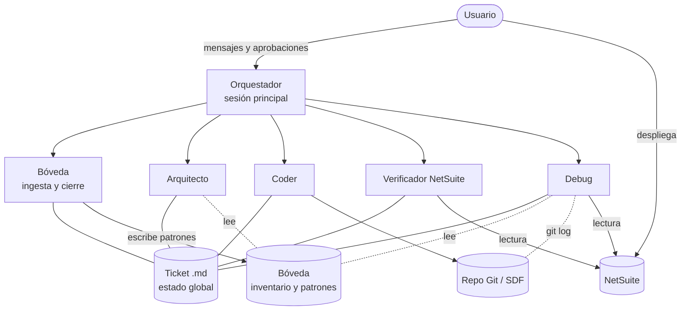
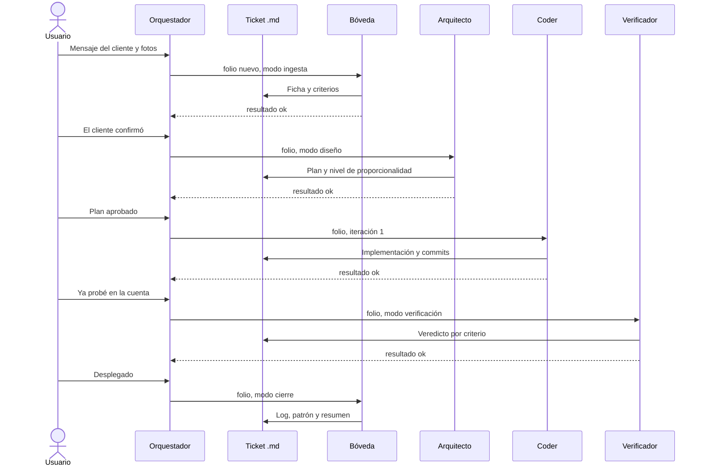
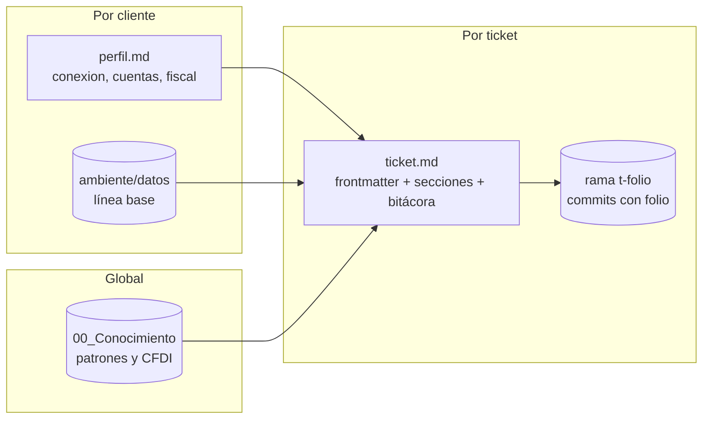
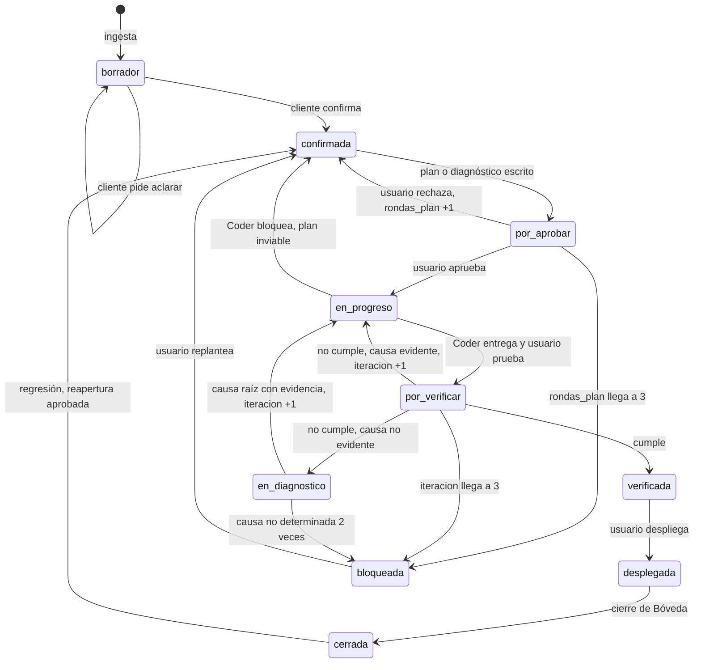

# Arquitectura multiagente – Flujo de desarrollo NetSuite v0.4

Nov 4, 2026 · @Alex

## Resumen

La arquitectura recomendada es un supervisor jerárquico que ejecuta una máquina de estados persistida en el archivo del ticket. El supervisor es la sesión principal de Claude Code. Trabaja con cinco subagentes especialistas y tres puertas humanas.

Esta revisión parte del diseño v0.3 y de los acuerdos posteriores: consolidación por permisos, agente Debug y modo sin MCP. Agrega tres piezas que faltaban: un orquestador explícito, un contrato de entrada y salida entre agentes, y límites de iteración con escalamiento.

| Decisión | Elección | Motivo |
| --- | --- | --- |
| Topología | Supervisor jerárquico con máquina de estados | En Claude Code la sesión principal delega y los subagentes no se comunican entre sí |
| Agentes | Orquestador y 5 especialistas | Se agrupan por permisos y por la confianza de su entrada, no por tema |
| Estado | Archivo del ticket, perfil, inventario y Git | Los subagentes no guardan memoria; el estado debe sobrevivir a sesiones y equipos |
| Loops | Acotados con contador y escalamiento | Evitan ciclos infinitos y rechazos repetidos sin información nueva |
| Acceso a NetSuite | Un puerto con tres adaptadores: `mcp`, `sdf`, `manual` | Hay clientes que no autorizarán MCP |
| Fuera de alcance | Contratos, cotizaciones, cobros y propiedad del código | Informativo; nunca bloquea el flujo |



El usuario es el único actor que despliega y el único que aprueba. Ningún subagente habla con otro: toda comunicación pasa por el orquestador y por el archivo del ticket.

## 1. Definición de agentes

Se necesitan un orquestador y cinco especialistas. La regla de agrupación es: se juntan las responsabilidades que usan las mismas herramientas y reciben entradas con el mismo nivel de confianza; se separan las que procesan texto del cliente o requieren más privilegios. La backstory va en la primera línea del prompt del agente, y su función es fijar el criterio, no el tono.

### Orquestador (sesión principal de Claude Code)

| Atributo | Definición |
| --- | --- |
| Rol | Dueño del flujo. Lee el estado del ticket, aplica la tabla de transiciones, delega al agente que corresponde y hace cumplir las puertas y los límites. |
| Backstory | Jefe de proyecto técnico que no programa. Su valor es que nada avance sin cumplir su condición de salida. |
| Metas | Ninguna transición sin precondición. Toda delegación con folio y modo. Es el único que escribe `estado` y los contadores. |
| Skills | `orquestacion-ticket` (nueva): tabla de transiciones, límites y formato del contrato |
| No hace | No diseña, no programa, no diagnostica, no consulta NetSuite |

### Bóveda (modos ingesta y cierre)

| Atributo | Definición |
| --- | --- |
| Rol | Único punto de entrada y salida de información. En ingesta convierte el mensaje del cliente en una ficha; en cierre escribe el log privado, la ficha de conocimiento y el resumen para el cliente. |
| Backstory | Analista de soporte que convierte conversaciones informales en requerimientos verificables y después archiva lo aprendido sin exponer al cliente. |
| Metas | Ficha con un máximo de 5 criterios verificables y ningún dato inventado. Ficha de conocimiento sin identificadores del cliente. |
| Skills | Precargada: `documentador-boveda`. Bajo demanda: `netsuite-sdf-project-documentation`. |
| No hace | No propone soluciones, no consulta NetSuite, no ejecuta comandos. Recibe texto no confiable, por eso no tiene Bash ni MCP. |

### Arquitecto

| Atributo | Definición |
| --- | --- |
| Rol | Diseña la solución de los requerimientos. Declara el nivel de proporcionalidad (0 a 3), cita antecedentes de la bóveda y propone las consultas de verificación. |
| Backstory | Arquitecto SuiteCloud con experiencia en la localización mexicana, que elige la solución más simple que cumple los criterios. |
| Metas | Plan aprobado en un máximo de 2 rondas (supuesto). Nivel de proporcionalidad justificado. Antecedentes citados o "sin antecedentes" declarado. |
| Skills | Precargadas: `netsuite-plan-diseno`, `netsuite-arquitectura-limpia`. Bajo demanda: `netsuite-sdf-safe-guide`, `netsuite-suitescript-records-reference`, `fiscal-cfdi` (modo diseño), `netsuite-sdf-roles-and-permissions`. |
| No hace | No escribe código ni consulta la cuenta; trabaja con el inventario de la bóveda. |

### Coder

| Atributo | Definición |
| --- | --- |
| Rol | Implementa el plan aprobado en la rama `t-<folio>` y hace una autorrevisión antes del commit. |
| Backstory | Desarrollador SuiteScript 2.1 disciplinado con la gobernanza, que trata cada commit como evidencia rastreable. |
| Metas | Cada commit con el folio en el mensaje. Ninguna desviación del plan sin declararla. Nunca agrega capas que el nivel de proporcionalidad no pide. |
| Skills | Precargadas: `netsuite-sdf-safe-guide`, `netsuite-arquitectura-limpia`. Bajo demanda: `netsuite-owasp-secure-coding`, `netsuite-suitescript-records-reference`, `netsuite-suitescript-upgrade`, `fiscal-cfdi`. |
| No hace | No despliega. No cambia el diseño: si el plan no es viable, lo devuelve como bloqueo. |

### Verificador NetSuite (modos verificación y levantamiento)

| Atributo | Definición |
| --- | --- |
| Rol | Verifica los criterios de aceptación contra la cuenta, valida el XML fiscal cuando aplica, y levanta y compara el inventario del ambiente. |
| Backstory | QA con mentalidad de auditor: pocas pruebas, y cada una demuestra algo. |
| Metas | Máximo 5 consultas por ticket. Veredicto y evidencia por criterio. Ninguna consulta en producción sin confirmación. |
| Skills | Precargada: `netsuite-ai-connector-instructions`. Bajo demanda: `levantamiento-ambiente`, `fiscal-cfdi` (modo validación). |
| No hace | No modifica datos ni código. No inventa consultas fuera del plan sin justificarlas. |

### Debug

| Atributo | Definición |
| --- | --- |
| Rol | Encuentra la causa raíz de una falla con evidencia, en contexto de iteración (dentro del ticket) o de post-despliegue (puede proponer reabrir un ticket anterior). |
| Backstory | Ingeniero de soporte de nivel 3 que no acepta una causa sin evidencia que la sostenga. |
| Metas | Causa raíz con evidencia, o "no determinada" con las hipótesis descartadas. Ruta de corrección. Folio de origen cuando la falla es regresiva. |
| Skills | Precargada: `debug-netsuite` (nueva). Bajo demanda: `fiscal-cfdi` (modo diagnóstico), `netsuite-sdf-safe-guide`, `netsuite-suitescript-records-reference`, `netsuite-ai-connector-instructions`. |
| No hace | No crea tickets: exige un folio. No escribe código. |

`fiscal-cfdi` es la única fuente de verdad fiscal y tiene tres modos: diseño (Arquitecto), diagnóstico (Debug) y validación (Verificador). Ningún agente precarga más de dos skills; el resto entra solo cuando el ticket lo requiere.

## 2. Herramientas

Cada agente recibe solo las herramientas que su rol exige; la lista permitida de su archivo es el control técnico, y el prompt es solo el respaldo. No se usan bases vectoriales, raspadores web ni APIs propias: la bóveda se consulta por texto y NetSuite se accede por un puerto con tres adaptadores.

### Matriz de herramientas

| Herramienta | Orquestador | Bóveda | Arquitecto | Coder | Verificador | Debug |
| --- | --- | --- | --- | --- | --- | --- |
| Read, Glob, Grep | Sí | Sí | Sí | Sí | Sí | Sí |
| Write, Edit en la bóveda | Solo frontmatter | Sí | Sección Plan | Sección Implementación | Sección Verificación e inventario | Sección Diagnóstico |
| Write, Edit en el repo | No | No | No | Sí | No | No |
| Bash | No | No | No | Repo y Git, sin deploy | Solo scripts del kit | Solo lectura: `git log`, `git diff`, `git blame` |
| Skill | Sí | Sí | Sí | Sí | Sí | Sí |
| MCP `ns_runCustomSuiteQL` | No | No | No | No | Sí | Sí |
| MCP `ns_getSubsidiaries` | No | No | No | No | Sí | No |
| Delegar a subagentes | Sí | No | No | No | No | No |

El nombre `ns_runCustomSuiteQL` está confirmado en la skill oficial de Oracle. El prefijo `mcp__netsuite__` que Claude Code le antepone se confirma con `/mcp` en el equipo. Las restricciones de Bash por agente son instrucciones del prompt; la única restricción técnica actual es la denegación de `suitecloud project:deploy` en el repo.

### Scripts deterministas

Toda operación que debe dar siempre el mismo resultado la hace un script, no el modelo.

| Script | Lo usa | Función |
| --- | --- | --- |
| `nuevo-cliente.mjs` | Usuario | Alta del cliente, URL del MCP y detección de entorno |
| `diff-ambiente.mjs` | Verificador | Altas, bajas y cambios del inventario contra la línea base |
| `importar-resultado.mjs` (nuevo) | Verificador, Debug | Convierte un CSV exportado o el JSON de la consola al formato del inventario |
| Hook `PreToolUse` de producción (propuesto) | Claude Code | Bloquea llamadas MCP a un host sin `-sb` salvo que exista una confirmación fechada del día creada por el usuario |

El hook convierte la confirmación de producción de una instrucción del prompt en una barrera técnica. Es la mejora de seguridad con mejor relación costo-beneficio de esta revisión.

### Adaptadores de acceso a NetSuite

El campo `conexion` del perfil decide el adaptador. Las etapas del flujo no cambian.

| Función | `mcp` | `sdf` | `manual` |
| --- | --- | --- | --- |
| Consultas de verificación | MCP directo | El agente genera la consulta; tú la ejecutas en la consola del navegador y guardas el JSON | Igual que `sdf` |
| Inventario de objetos | SuiteQL por MCP | `suitecloud object:list` (supuesto: filtro por tipo) | CSV de búsquedas guardadas |
| Logs para Debug | SuiteQL si la tabla está disponible (supuesto) | Exportación CSV desde la UI | Igual que `sdf` |
| Despliegue | SDF, por el usuario | SDF, por el usuario | File Cabinet y UI, por el usuario |

### Herramientas descartadas

| Herramienta | Motivo | Cuándo reconsiderarla |
| --- | --- | --- |
| Base de datos vectorial | La bóveda es pequeña y el vocabulario controlado permite búsqueda exacta por texto | Cuando el Arquitecto o el Debug no encuentren fichas que sí existen |
| Raspado web y búsqueda web | Contenido no confiable con riesgo de inyección de prompt; las fuentes fiscales se descargan y versionan a mano | Si el piloto muestra que el Debug necesita documentación de Oracle que no está en las skills; en ese caso, solo el Debug y solo dominios de Oracle |
| RESTlet propio | Agrega despliegue, autenticación y mantenimiento por cuenta | Si un caso exige leer algo que ni MCP ni la consola exponen |

## 3. Patrón de comunicación

El patrón correcto es híbrido: un supervisor jerárquico decide quién actúa, y una máquina de estados explícita decide cuándo puede actuar. Los agentes no se hablan entre sí. Se comunican mediante un contrato fijo con el orquestador y escriben en secciones del ticket.

### Comparación de patrones

| Patrón | Ajuste a este caso | Motivo |
| --- | --- | --- |
| Secuencial en cadena | Insuficiente | El flujo tiene tres ciclos de retorno y dos rutas (requerimiento y bug); una cadena rígida no los expresa |
| Red libre entre agentes | Descartado | Claude Code no permite que un subagente delegue en otro, y la comunicación directa rompe la trazabilidad y las puertas humanas |
| Grafo de estados puro (estilo LangGraph) | Correcto en concepto, sobredimensionado en infraestructura | Requiere un runtime propio; el mismo efecto se logra con una tabla de transiciones y un campo `estado` en un archivo |
| Supervisor jerárquico con máquina de estados | Elegido | Coincide con el modelo de ejecución de Claude Code y hace las transiciones deterministas y auditables |

El supervisor no improvisa la ruta. La tabla de transiciones vive en la skill `orquestacion-ticket` y es la misma en todos los tickets.

### Tabla de transiciones

| Estado actual | Evento | Actúa | Estado siguiente |
| --- | --- | --- | --- |
| (sin ticket) | Mensaje del cliente | Bóveda, modo ingesta | `borrador` |
| `borrador` | El cliente confirma | Arquitecto (requerimiento) o Debug (bug) | `confirmada` |
| `confirmada` | Plan o diagnóstico escrito | Usuario (puerta) | `por_aprobar` |
| `por_aprobar` | El usuario aprueba | Coder | `en_progreso` |
| `en_progreso` | Coder entrega | Usuario prueba en la cuenta | `por_verificar` |
| `por_verificar` | El usuario reportó su prueba | Verificador | `verificada` o vuelve a `en_progreso` |
| `verificada` | El usuario despliega (puerta) | Bóveda, modo cierre | `desplegada`, después `cerrada` |
| Cualquiera | Bloqueo o límite de iteración alcanzado | Usuario | `bloqueada` |

Esta tabla amplía los estados del kit v0.3 (`borrador`, `confirmada`, `en_progreso`, `desplegada`, `cerrada`) con `por_aprobar`, `por_verificar`, `verificada` y `bloqueada`. Los nuevos estados permiten saber, solo con el frontmatter, quién tiene el turno.

### Contrato entre orquestador y agentes

Entrada: el mensaje de delegación del orquestador. Es lo único que recibe el subagente, además de su propio prompt.

```yaml
folio: T-2026-014
agente: verificador
modo: verificacion            # ingesta | cierre | verificacion | levantamiento | iteracion | post_despliegue
ruta_ticket: <BOVEDA_CLIENTE>/tickets/T-2026-014.md
iteracion: 2
instrucciones: "texto del usuario, si aplica"
```

Salida: un bloque YAML al final de la respuesta del subagente.

```yaml
folio: T-2026-014
agente: verificador
resultado: rechazo            # ok | rechazo | bloqueo
seccion_escrita: Verificación
siguiente_sugerido: coder     # el orquestador decide con la tabla, no con esta sugerencia
motivo: "Criterio 2 no cumple: el campo queda vacío en la factura de prueba"
evidencia: ["consulta 2", "registro de prueba indicado por el usuario"]
causa_evidente: true          # solo Verificador: decide entre Coder y Debug
```

Reglas del contrato: el subagente no cambia `estado`; un `rechazo` o `bloqueo` sin `motivo` y `evidencia` se trata como inválido y se repite la delegación una vez; el detalle largo va en la sección del ticket, no en la respuesta.



## 4. Gestión del estado

El estado global vive en archivos, no en la conversación. El frontmatter del ticket es la única fuente de verdad del flujo, y cada variable tiene un solo escritor. Así el sistema se puede retomar en otra sesión, en otro equipo o después de una interrupción, con solo leer el ticket.

### Por qué en archivos

| Razón | Consecuencia si el estado viviera en la conversación |
| --- | --- |
| Los subagentes no guardan memoria entre invocaciones | Cada delegación tendría que reconstruir el contexto a partir del chat, con riesgo de omitir datos |
| Las sesiones terminan y cambias de equipo | Un ticket a medias se perdería al cerrar la terminal |
| El estado debe ser legible y editable por ti | No podrías corregir un dato mal registrado sin reiniciar el flujo |
| Las métricas salen de Dataview | No habría tablero |

### Capas de estado



### Variables críticas del ticket

| Variable | Escribe | La usa | Por qué es crítica |
| --- | --- | --- | --- |
| `folio` | Bóveda (ingesta) | Todos | Llave de todo: rama, commits, delegaciones. El Debug no actúa sin él. |
| `cliente_id` | Bóveda | Todos | Selecciona el perfil y aísla los datos del cliente |
| `tipo` | Bóveda | Orquestador | Decide la ruta: Arquitecto para requerimientos, Debug para bugs |
| `impacto_fiscal` | Bóveda; el Arquitecto y el Debug solo pueden cambiarlo de `false` a `true` | Arquitecto, Coder, Verificador, Debug | Activa `fiscal-cfdi`. El cambio en un solo sentido evita que un agente apague una revisión fiscal. |
| `estado` | Orquestador | Orquestador, Dataview | Dice quién tiene el turno |
| `iteracion` | Orquestador | Orquestador, Coder, Debug | Contador del ciclo Coder-Verificador; dispara el escalamiento |
| `rondas_plan` | Orquestador | Orquestador | Contador de rechazos del plan |
| `nivel_proporcionalidad` | Arquitecto | Coder | Impide que el Coder agregue capas que el diseño no pidió |
| `rama` | Coder | Debug | Ubica el código del ticket |
| `entorno_verificado` | Verificador | Usuario, Bóveda | Registra si la evidencia salió de Sandbox o de producción |
| `reabierto`, `ticket_origen` | Orquestador, tras tu aprobación de la propuesta del Debug | Dataview | Alimentan la métrica 1, errores que llegan a producción |
| `bloqueo_motivo` | Orquestador | Usuario | Explica por qué el ticket se detuvo |
| `fecha_recepcion`, `fecha_confirmada`, `fecha_plan`, `fecha_deploy` | Bóveda la primera; el Orquestador las de las puertas | Dataview | Métricas de tiempo de diagnóstico y ciclo |

Variables del cliente, en el perfil: `conexion` (`mcp`, `sdf` o `manual`), cuentas con su URL del MCP, `solucion_fiscal` y `fecha_ultimo_levantamiento`. Las escribe el usuario o el Verificador en modo levantamiento.

### Reglas de gestión

1. Un escritor por variable. Si dos agentes necesitan cambiar un dato, uno lo escribe y el otro lo solicita mediante `bloqueo` con motivo.
2. Los criterios de aceptación no cambian después de `confirmada`. Un cambio de alcance regresa el ticket al cliente.
3. La sección Bitácora del ticket solo admite agregar. El Orquestador escribe una línea por delegación: fecha, agente, modo, resultado y motivo corto. Ahí se detectan rechazos repetidos.
4. Al iniciar una sesión, el Orquestador valida que el `estado` coincida con las secciones escritas. Si no coinciden, por ejemplo `por_verificar` sin sección Implementación, lo reporta y no avanza.
5. Puedes editar el frontmatter a mano. La validación del punto 4 lo hace seguro.

## 5. Manejo de errores y loops

Todo rechazo debe traer motivo y evidencia. El ticket regresa al agente más cercano que puede corregir la causa, y cada ciclo tiene un límite: al alcanzarlo, el ticket pasa a `bloqueada` y te escala. Un rechazo que repite el mismo motivo que el anterior escala de inmediato, porque indica que el ciclo ya no produce información nueva.



El estado transitorio `en_diagnostico` se suma a la tabla de transiciones de la sección 3 para la iteración con Debug.

### Rechazos entre agentes

| Rechaza | A | Condición | Reacción | Límite (supuesto) | Al llegar al límite |
| --- | --- | --- | --- | --- | --- |
| Cliente | Bóveda | La ficha no refleja lo que pidió | La Bóveda reescribe con sus aclaraciones | Sin límite; lo controla una persona | — |
| Arquitecto | Bóveda | Criterio ambiguo o no verificable | Vuelve a `borrador` con preguntas para el cliente | 2 | Lo resuelves tú directamente con el cliente |
| Usuario | Arquitecto | El plan no convence | El Arquitecto rehace el plan con tus observaciones | 3 rondas | `bloqueada`: replantear el alcance |
| Coder | Arquitecto | Plan inviable: gobernanza, campo inexistente, límite de plataforma | `bloqueo` con motivo; el Arquitecto ajusta | Cuenta como ronda de plan | Igual que la fila anterior |
| Verificador | Coder | No cumple y la causa es evidente | El Coder corrige en la misma rama | 3 iteraciones compartidas con la fila siguiente | `bloqueada`: revisión del diseño con el Arquitecto |
| Verificador | Debug | No cumple y la causa no es evidente | Debug en modo iteración; después, Coder | Mismo contador | Igual que la fila anterior |
| Usuario | Debug | El diagnóstico no tiene evidencia suficiente | Debug con los datos nuevos que aportes | 2 | `bloqueada`: se necesita reproducir la falla |
| Orquestador | Cualquiera | La salida no cumple el contrato | Repite la delegación una vez | 1 | `bloqueada` con la salida inválida anexada |

### Fallas técnicas

| Falla | Reacción | Por qué |
| --- | --- | --- |
| MCP responde 403 o falta un permiso | Registrar la limitación del rol y resolver ese paso con el adaptador manual | Buscar rutas alternas produce consultas no aprobadas |
| MCP no responde | Un reintento; después, adaptador manual | Que no responda no significa que no haya datos |
| Host sin `-sb` y sin confirmación | Detener sin consultar | Ante una duda sobre el entorno, la falla debe ser cerrada |
| Error del script de diferencias | No aplicar la línea base | Una línea base corrupta genera falsas bajas en todas las comparaciones siguientes |
| Skill no precargada | Invocarla con la herramienta Skill; si no existe, declararlo y continuar | Hay un reporte abierto de fallas en la precarga |
| Conflicto de Git en la rama | `bloqueo` hacia el usuario | Resolver conflictos requiere decidir qué código prevalece |
| Falla en producción después del despliegue | Ficha nueva de tipo bug; el Debug rastrea con `git blame` y propone reabrir el ticket de origen | Medir bien la métrica 1 depende de no registrar las regresiones como tickets nuevos |

Los límites de 2 y 3 son valores iniciales sin medición. Se ajustan con los datos de la bitácora después de los primeros tickets.

## 6. Riesgos, supuestos y verificación

El diseño es sólido para un desarrollador único, con un riesgo dominante: varios controles todavía son instrucciones de prompt y no barreras técnicas. El hook de producción y la validación de estado al iniciar la sesión son las dos mejoras que reducen ese riesgo.

### Riesgos

| Riesgo | Fundamento | Consecuencia | Mitigación |
| --- | --- | --- | --- |
| Las restricciones de Bash por agente dependen del prompt | La lista de herramientas permite Bash completo | Un agente desviado podría ejecutar comandos fuera de su alcance | Reglas `deny` adicionales en `settings.json` y el hook de producción |
| El Orquestador es la sesión principal, que también conversa contigo | Comparte contexto con instrucciones libres del usuario | Podría saltarse una transición si se lo pides de forma ambigua | La skill `orquestacion-ticket` y la validación de estado al iniciar |
| La precarga de skills puede fallar | Existe un reporte abierto sobre el campo `skills` | El agente arranca sin su conocimiento de dominio | Instrucción de invocarlas con Skill y una pregunta de control en el piloto |
| Los límites de iteración son supuestos | No hay datos históricos | Límites demasiado bajos bloquean tickets sanos; demasiado altos consumen tiempo | Ajustarlos con la bitácora tras unos 10 tickets |
| En los modos `sdf` y `manual`, la verificación la ejecutas tú | Sin MCP no hay consulta automática | Cada consulta cuesta tiempo humano | El límite de 5 consultas se vuelve obligatorio |

### Supuestos por validar en el piloto

1. El prefijo `mcp__netsuite__` de las herramientas MCP en Claude Code.
2. La disponibilidad de las tablas del catálogo de levantamiento y de los logs de ejecución por SuiteQL con un rol de solo lectura.
3. El filtro por tipo de `suitecloud object:list`.
4. El uso de `N/query` desde la consola del navegador en cada cuenta.
5. Que `suitecloud project:create` crea una subcarpeta con el nombre del proyecto.

### Cambios que implica esta revisión (kit v0.4)

| Cambio | Tipo |
| --- | --- |
| Consolidar de 7 a 5 agentes, agrupados por permisos | Agentes |
| Agente Debug y skill `debug-netsuite` | Nuevo |
| Skill `orquestacion-ticket` con la tabla de transiciones y el contrato | Nuevo |
| Estados `por_aprobar`, `por_verificar`, `verificada`, `en_diagnostico` y `bloqueada`; variables `iteracion`, `rondas_plan`, `ticket_origen` y `bloqueo_motivo`; sección Bitácora | Plantilla de ticket |
| `fiscal-cfdi` con tres modos | Skill |
| Campo `conexion` y script `importar-resultado.mjs` | Modo sin MCP |
| Hook `PreToolUse` de producción | Seguridad |
| Proyecto SDF en `sdf/` y dos servidores MCP, Sandbox y producción | Alta de cliente |

### Verificación

Esta revisión es de diseño y no se ejecutó código. Contrasté el diseño con el kit v0.3: las skills de Oracle existen en el [repositorio oficial](https://github.com/oracle/netsuite-suitecloud-sdk) y el nombre `ns_runCustomSuiteQL` aparece en su skill de AI Connector. El comportamiento de los subagentes de Claude Code (campo `skills`, ausencia de delegación entre subagentes) se tomó de su documentación y de reportes públicos, sin prueba en un equipo. Los límites y tiempos son supuestos sin medición.
